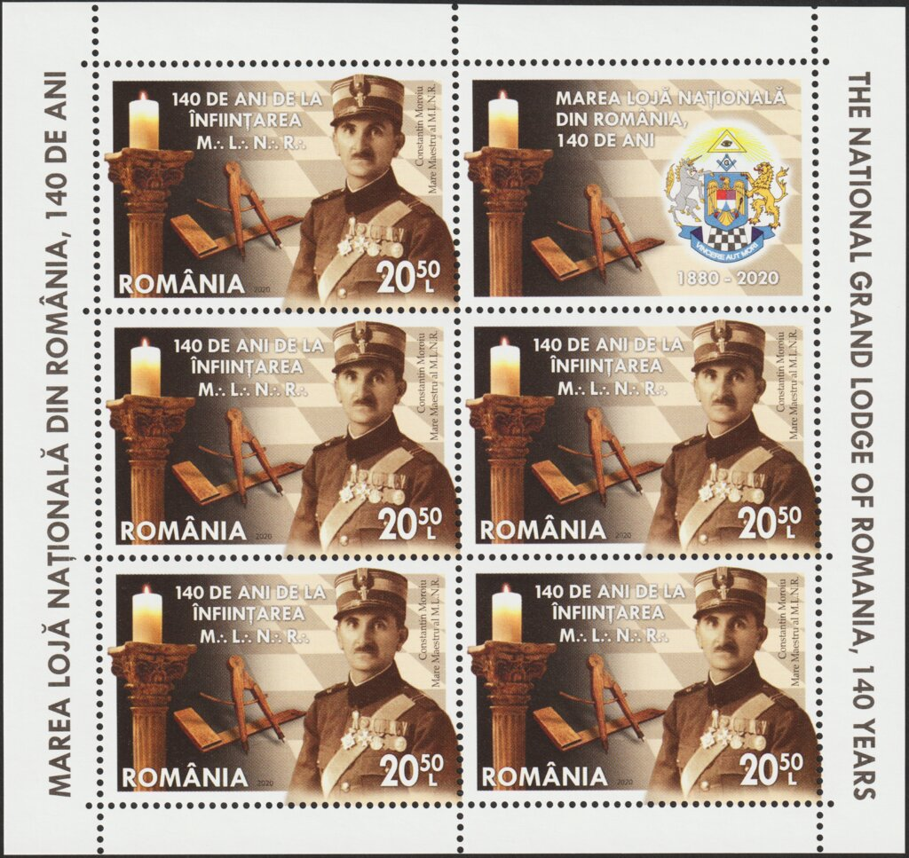

## 🐃 1 🆁 Replica ⏭ Moroiu

<!-- u:u00897 kind:text -->
1881 📅 1889

<!-- u:u00898 kind:quad -->
Constantin M. Moroiu (February 13, 1839 – April 27, 1918) participated in the 1877 War of Independence as a captain in the royal army and was also a prominent 33° Freemason, affiliated with the Marea Lojă Naţională Unită din România. Moroiu played a key role in the Romanian philatelic community, being a founding member of the Romanian Philatelic Society. In 1881, he launched Romania's first philatelic magazine, Timbrophilo, where he promoted the idea of an earlier Moldavian stamp issue that supposedly preceded the famous Cap de Bour stamps. According to Moroiu, there were handmade stamps used in Moldova between 1852 and 1853 with values of 15, 45, 90, and 135 parale. 
Moroiu later purchased printing plates of Romanian stamps issued before 1872 from a local workshop and began producing counterfeit stamps. Though he sold these with the disclaimer that they were not original, the authorities intervened after receiving a complaint. On March 8, 1889, Grigore Mocioaca, a tobacco shop owner, reported Moroiu to the authorities. The Chief Prosecutor of Ilfov, Boldur Voinescu, along with police officers, raided the "Universul" printing house, where Moroiu's stamps were being made. The investigation also involved Luigi Cazzavilan, the director of the "Universul" newspaper, who cooperated with the authorities.
Following the raid on the printing house, Moroiu’s home was searched, and thousands of outdated Moldavian, United Principalities, and Romanian stamps were found. Despite this, Moroiu avoided charges due to insufficient evidence. Later, a tip led the prosecutor back to the site, where it was claimed that old Cap de Bour printing plates were buried behind an outhouse. Moroiu was arrested and sent to the Văcărești prison, where he attempted suicide but survived. The case dragged on, with prosecutors lacking the legal framework to address this unique philatelic crime. Eventually, due to a lack of concrete evidence that Moroiu had sold his forgeries as genuine, he was acquitted.
Not long after the trial, Moroiu established the Societatea Filatelică Română, the first philatelic society in Romania, and became its secretary, solidifying his legacy in Romanian philately despite his controversial past.

<!-- u:u00899 kind:table -->

| Figure 177: Moroiu 🆁 45 Parale |
|---|
| Figure 178: 📖 MI RO 7690KB |

<!-- u:u00900 kind:table -->
| Constantin M. Moroiu (13 février 1839 - 27 avril 1918) a participé à la guerre d'indépendance de 1877 en tant que capitaine de l'armée royale et était également un éminent franc-maçon 33°, affilié à la Marea Lojă Naţională Unită din România. Moroiu a joué un rôle clé dans la communauté philatélique roumaine, étant un membre fondateur de la Société philatélique roumaine. En 1881, il a lancé le premier magazine philatélique de Roumanie, Timbrophilo, où il a défendu l'idée d'une émission antérieure de timbres moldaves qui aurait précédé les célèbres timbres du Cap de Bour. Selon Moroiu, des timbres artisanaux ont été utilisés en Moldavie entre 1852 et 1853 avec des valeurs de 15, 45, 90 et 135 parales.  Moroiu a ensuite acheté des plaques d'impression de timbres roumains émis avant 1872 auprès d'un atelier timbre et a commencé à produire des faux timbres. Bien qu'il ait vendu ces timbres en précisant qu'ils n'étaient pas originaux, les autorités sont intervenues après avoir reçu une plainte. Le 8 mars 1889, Grigore Mocioaca, propriétaire d'un bureau de tabac, dénonce Moroiu aux autorités. Le procureur général d'Ilfov, Boldur Voinescu, accompagné de policiers, fait une descente à l'imprimerie « Universul », où sont fabriqués les timbres de Moroiu. L'enquête a également impliqué Luigi Cazzavilan, le directeur du journal « Universul », qui a coopéré avec les autorités. Après la perquisition de l'imprimerie, le domicile de Moroiu a été fouillé et des milliers de timbres périmés de Moldavie, des Principautés unies et de Roumanie ont été découverts. Malgré cela, Moroiu n'a pas été inculpé, faute de preuves suffisantes. Plus tard, un tuyau a ramené le procureur sur le site, où l'on a affirmé que d'anciennes plaques d'impression de Cap de Bour étaient enterrées derrière une dépendance. Moroiu a été arrêté et envoyé à la prison de Văcărești, où il a tenté de se suicider mais a survécu. L'affaire a traîné en longueur, les procureurs ne disposant pas du cadre juridique nécessaire pour s'attaquer à ce crime philatélique unique. Finalement, faute de preuves concrètes que Moroiu avait vendu ses faux comme des authentiques, il a été acquitté. Peu de temps après le procès, Moroiu a créé la Societatea Filatelică Română, la première société philatélique de Roumanie, et en est devenu le secrétaire, consolidant ainsi son héritage dans la philatélie roumaine malgré son passé controversé. | Constantin M. Moroiu (13. Februar 1839 - 27. April 1918) nahm als Hauptmann der königlichen Armee am Unabhängigkeitskrieg von 1877 teil und war außerdem ein prominenter Freimaurer des 33. Grades, der der Marea Lojă Naţională Unită din România angehörte. Moroiu spielte eine Schlüsselrolle in der rumänischen Philatelie und war Gründungsmitglied der Rumänischen Philatelistischen Gesellschaft. Im Jahr 1881 rief er die erste rumänische Philateliezeitschrift Timbrophilo ins Leben, in der er die Idee einer früheren moldawischen Briefmarkenausgabe propagierte, die den berühmten Cap de Bour-Marken vorausgegangen sein soll. Laut Moroiu wurden in Moldawien zwischen 1852 und 1853 handgefertigte Briefmarken mit Werten von 15, 45, 90 und 135 Parale verwendet.  Moroiu kaufte später Druckplatten rumänischer Briefmarken, die vor 1872 ausgegeben worden waren, von einer örtlichen Werkstatt und begann mit der Herstellung gefälschter Briefmarken. Obwohl er diese mit dem Hinweis verkaufte, dass es sich nicht um Originale handelte, schritten die Behörden ein, nachdem sie eine Beschwerde erhalten hatten. Am 8. März 1889 zeigte Grigore Mocioaca, ein Tabakladenbesitzer, Moroiu bei den Behörden an. Der Oberstaatsanwalt von Ilfov, Boldur Voinescu, führte zusammen mit Polizeibeamten eine Razzia in der Druckerei „Universul“ durch, wo Moroius Briefmarken hergestellt wurden. In die Ermittlungen wurde auch Luigi Cazzavilan, der Direktor der Zeitung „Universul“, einbezogen, der mit den Behörden kooperierte. Nach der Razzia in der Druckerei wurde Moroius Wohnung durchsucht, wobei Tausende veralteter Briefmarken der Republik Moldau, der Vereinigten Fürstentümer und Rumäniens gefunden wurden. Trotzdem wurde Moroiu nicht angeklagt, da die Beweise nicht ausreichten. Später führte ein Hinweis die Staatsanwaltschaft zurück an den Ort, an dem angeblich alte Cap de Bour-Druckplatten hinter einem Nebengebäude vergraben waren. Moroiu wurde verhaftet und in das Gefängnis von Văcărești gebracht, wo er einen Selbstmordversuch unternahm, aber überlebte. Der Fall zog sich in die Länge, da den Staatsanwälten der rechtliche Rahmen fehlte, um dieses einzigartige philatelistische Verbrechen aufzuklären. Mangels konkreter Beweise dafür, dass Moroiu seine Fälschungen als echt verkauft hatte, wurde er schließlich freigesprochen. Nicht lange nach dem Prozess gründete Moroiu die Societatea Filatelică Română, die erste philatelistische Gesellschaft in Rumänien, und wurde ihr Sekretär, wodurch sein Vermächtnis in der rumänischen Philatelie trotz seiner kontroversen Vergangenheit gefestigt wurde. |
|---|---|
