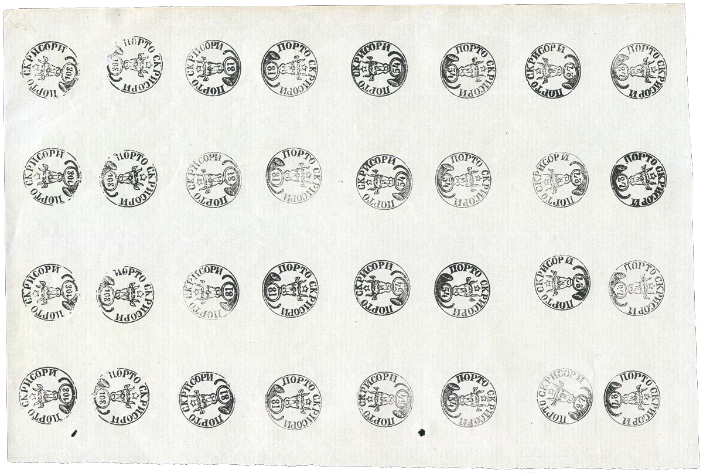

## 🐃 1 🆁 Replica ⏭ Gorjan

<!-- u:u00902 kind:text -->
1891 📅 1892

<!-- u:u00903 kind:quad -->

In 1891 the 4 dies were found in the Bucharest post office warehouse. The dies show small physical-mechanical degradations: small grooves on the surface of the metal (scratches or scratches) and physical-chemical degradations (black stains produced by the ink and corrosion at the base of the piece). 
During 26.02.1891 - 22.02.1892, the Director of the Post and Telegraph, Colonel Augustin Gorjan, ordered the hand printing on white paper striped in groups of 3 pieces of each value with black ink. 
These dies were later kept in the Conservatory of the Romanian Post Office and are currently on display in the National Philatelic Museum.
Figure 179: 🐃 1 🆁 Replica ⏭ Gorjan
