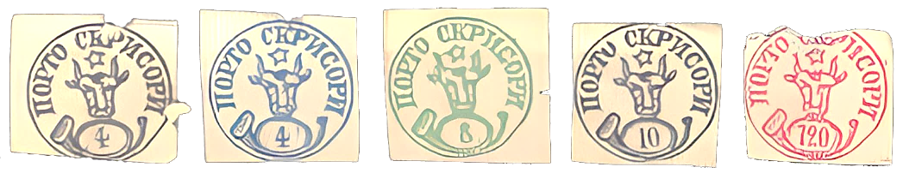
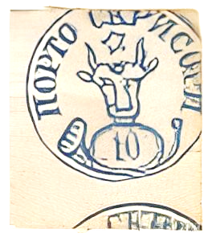
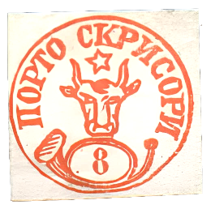
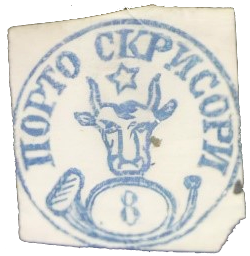
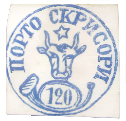
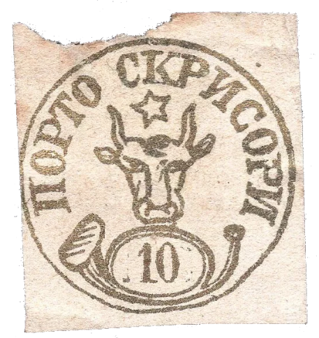
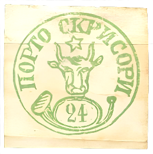

## 🐃 1 🆁 Replica ⏭ Adolf

<!-- u:u00908 kind:table -->

| 🆁 4, 8, 10, 120 Parale |  |  |
|---|---|---|
| 🆁 10 Parale | 🆁 8 Parale | 🆁 8 Parale |
| 🆁 120 Parale | 🆁 10 Parale | 🆁 24 Parale |

<!-- u:u00909 kind:text -->
Figure 181: 🐃 1 🆁 Replica ⏭ Adolf
