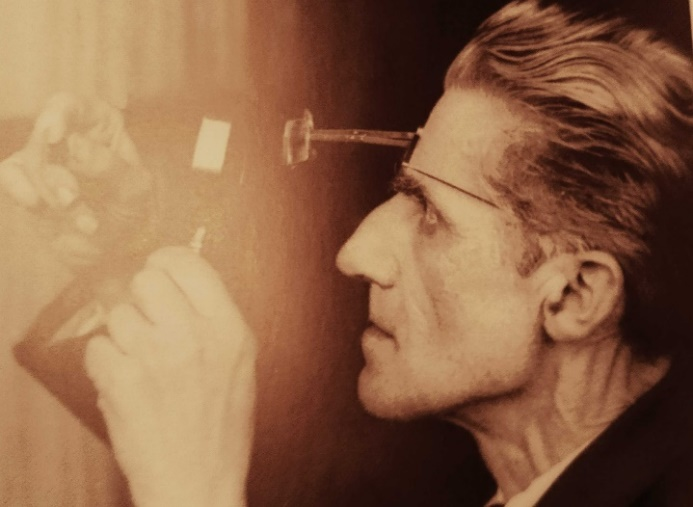
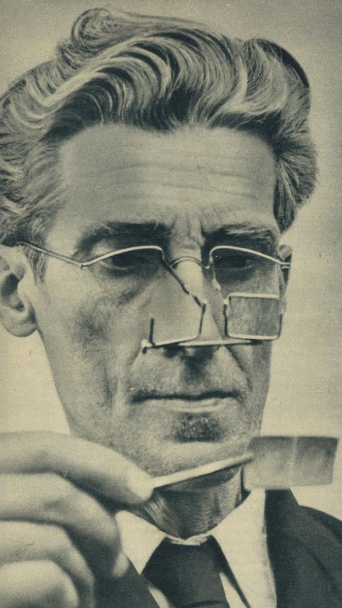
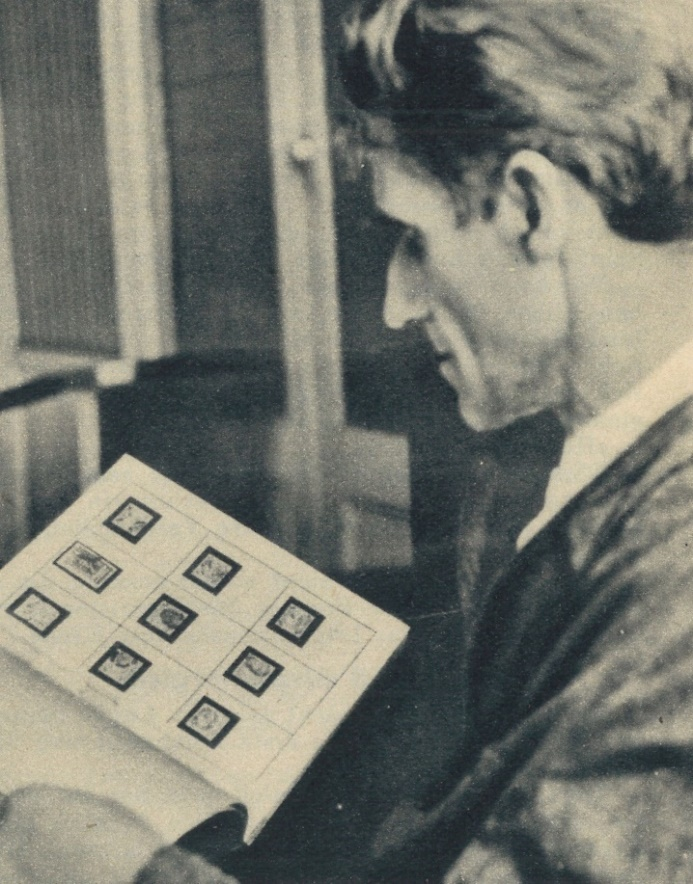
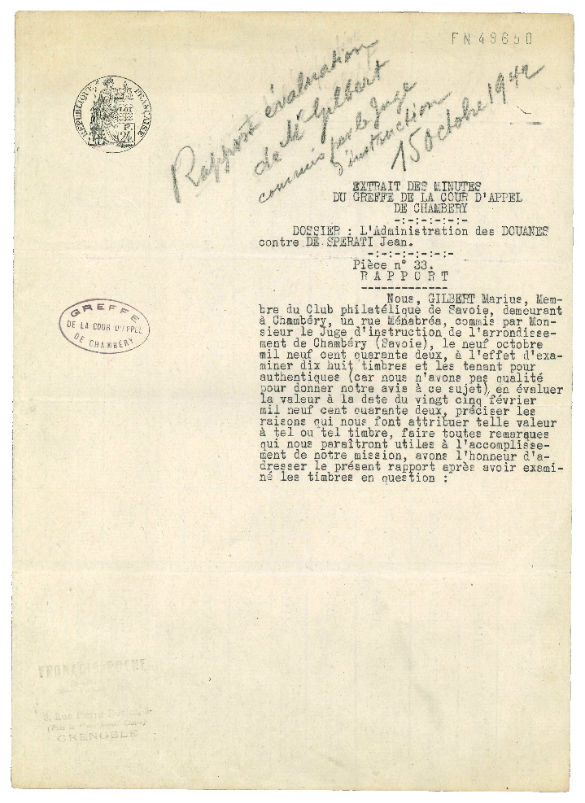
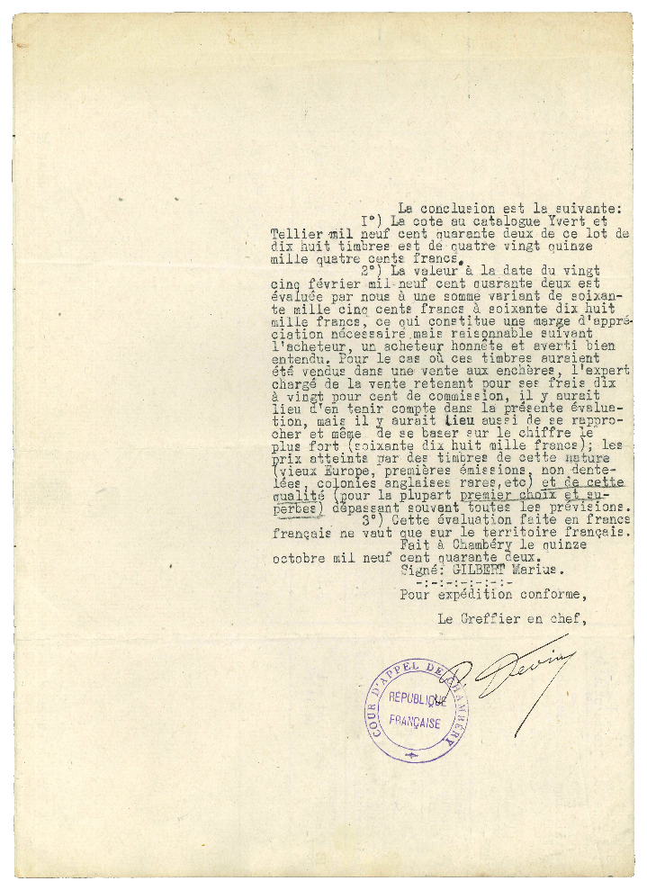
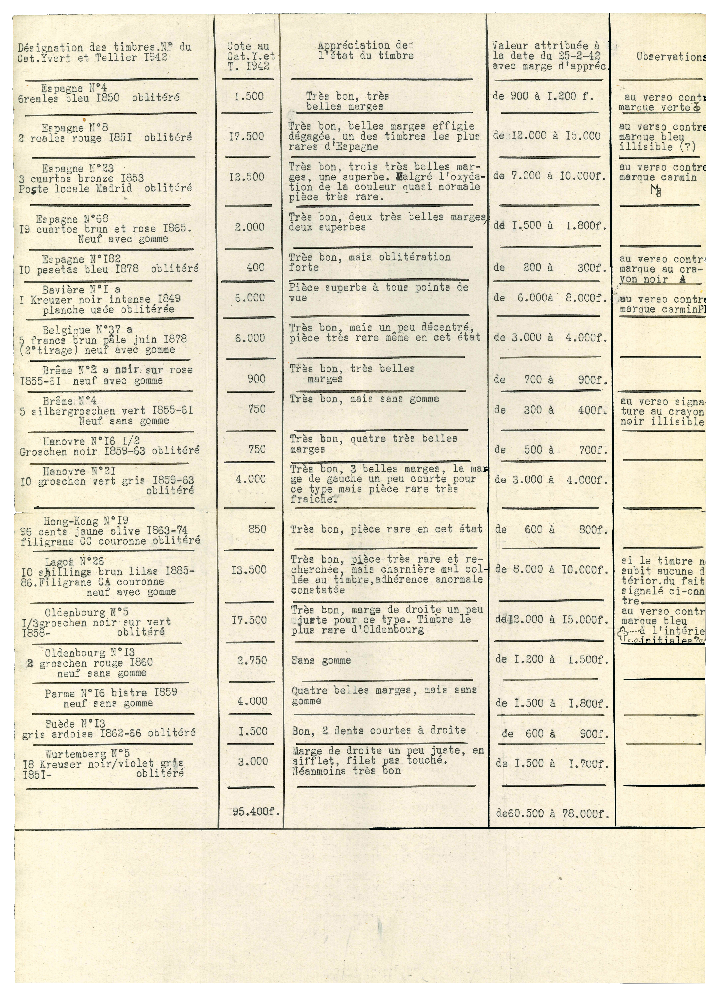
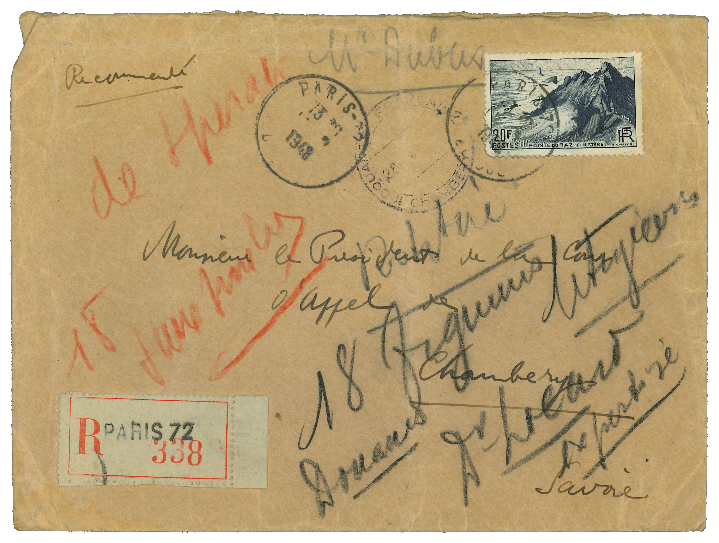
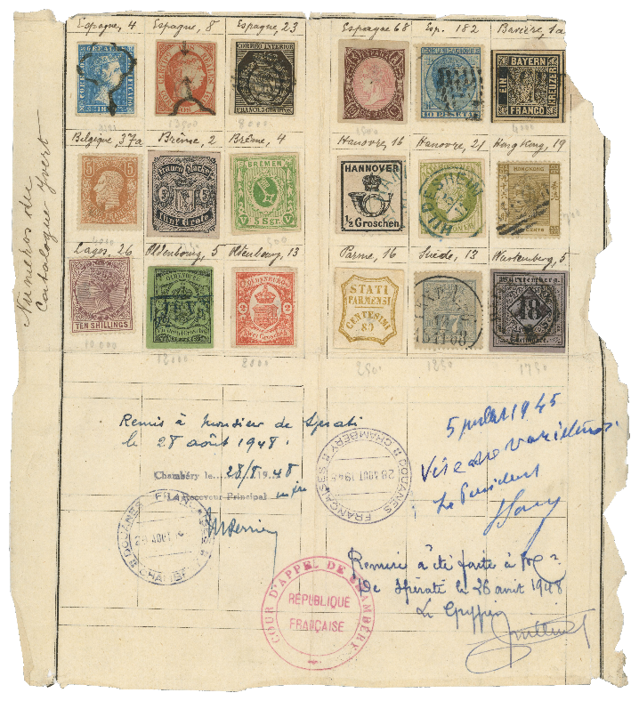

## 🐃 1 🆁 Replica ⏭ Sperati

<!-- u:u00911 kind:quad -->

Sperati's forgeries
Jean de Sperati (1884–1957) was one of the most infamous and skilled stamp forgers in history. His expertise was rooted in a deep understanding of chemistry, paper production, printing techniques, and philately, allowing him to create incredibly detailed replicas of rare stamps. Sperati referred to his forgeries as "works of art" and prided himself on the fact that they could fool even the most experienced experts. He created his Livre d’Or, a personal collection of 234 forged stamps that were certified as genuine by 17 different authorities across five countries.
Sperati's forgeries, produced with meticulous precision, remain highly sought after, with some replicas valued higher than the original stamps they imitate. He was able to reproduce not just the stamps but also the correct watermarks, perforations, and cancellations, often deceiving philatelic experts. 
In 1942, Jean de Sperati sent a sheet of 18 expertly crafted stamp reproductions to a dealer in Lisbon. The French customs intercepted the package, and Sperati was charged with exporting valuable stamps without declaration. Two experts initially examined the stamps, declaring them authentic, which led to Sperati being accused of capital evasion. Sperati insisted the stamps were forgeries and challenged the court's expertise. Eventually, another expert confirmed the stamps were reproductions but capable of deceiving collectors. Despite this, Sperati was fined for capital evasion, and the case gained international attention, cementing his fame.
Though he went on trial for forgery in 1943, Sperati maintained that his work was art, not forgery. His creations were made to order, and he even signed some pieces as replicas, though many unscrupulous dealers later erased these signatures and sold them as originals.
In 1950, as his eyesight deteriorated, Sperati sold his archives to the British Philatelic Association, leading to the publication of books that revealed the methods behind his forgeries and how to identify them. Despite his controversial legacy, Sperati is revered today, with his forgeries often fetching prices comparable to the original stamps. His meticulous methods, artistic skills, and extensive impact on philately have made him a unique figure, and his forgeries are now a collecting genre in their own right.

<!-- u:u00912 kind:table -->

| Les faux de Sperati Jean de Sperati (1884-1957) était l'un des faussaires de timbres les plus infâmes et les plus habiles de l'histoire. Son expertise reposait sur une connaissance approfondie de la chimie, de la production de papier, des techniques d'impression et de la philatélie, ce qui lui permettait de créer des répliques incroyablement détaillées de timbres rares. Sperati qualifiait ses contrefaçons d'« œuvres d'art » et s'enorgueillissait du fait qu'elles pouvaient tromper même les experts les plus expérimentés. Il a créé son Livre d'Or, une collection personnelle de 234 faux timbres dont l'authenticité a été certifiée par 17 autorités différentes dans cinq pays. Les faux de Sperati, réalisés avec une précision méticuleuse, restent très recherchés, certaines répliques ayant une valeur supérieure à celle des timbres originaux qu'elles imitent. Il était capable de reproduire non seulement les timbres, mais aussi les filigranes, les perforations et les oblitérations, trompant souvent les experts philatéliques. En 1942, Jean de Sperati envoie à un négociant de Lisbonne une feuille de 18 reproductions de timbres réalisées par des experts. Les douanes françaises interceptent le colis et Sperati est accusé d'avoir exporté des timbres de valeur sans déclaration. Deux experts ont d'abord examiné les timbres et les ont déclarés authentiques, ce qui a valu à Sperati d'être accusé d'évasion de capitaux. Sperati a insisté sur le fait que les timbres étaient des faux et a contesté l'expertise du tribunal. Finalement, un autre expert a confirmé que les timbres étaient des reproductions, mais qu'ils étaient capables de tromper les collectionneurs. Malgré cela, Sperati a été condamné à une amende pour fraude fiscale et l'affaire a attiré l'attention du monde entier, consolidant ainsi sa renommée. Bien qu'il ait été jugé pour contrefaçon en 1943, Sperati a maintenu que son travail était de l'art et non de la contrefaçon. Ses créations étaient réalisées sur commande et il a même signé certaines pièces en tant que répliques, bien que de nombreux marchands peu scrupuleux aient par la suite effacé ces signatures et les aient vendues en tant qu'originaux. En 1950, alors que sa vue se détériore, Sperati vend ses archives à la British Philatelic Association, ce qui donne lieu à la publication d'ouvrages qui révèlent les méthodes utilisées pour réaliser ses faux et permettent de les identifier. Malgré son héritage controversé, Sperati est aujourd'hui vénéré, ses faux atteignant souvent des prix comparables à ceux des timbres originaux. Ses méthodes méticuleuses, ses talents artistiques et son impact considérable sur la philatélie ont fait de lui un personnage unique, et ses faux constituent aujourd'hui un genre de collection à part entière. | Report \| Raport \| Rapport \| Bericht  Figure 184: Report 📅 1942-10-15 |
|---|---|

<!-- u:u00913 kind:table -->

| Figure 185: Report 📅 1942-10-15   Figure 186: ✉ Sperati 📅 1942 | Speratis Fälschungen Jean de Sperati (1884-1957) war einer der berüchtigtsten und geschicktesten Briefmarkenfälscher der Geschichte. Sein Fachwissen beruhte auf einem tiefen Verständnis der Chemie, der Papierherstellung, der Drucktechniken und der Philatelie, was es ihm ermöglichte, unglaublich detaillierte Repliken seltener Briefmarken zu erstellen. Sperati bezeichnete seine Fälschungen als „Kunstwerke“ und war stolz darauf, dass sie selbst die erfahrensten Experten täuschen konnten. Er schuf sein Livre d'Or, eine persönliche Sammlung von 234 gefälschten Briefmarken, die von 17 verschiedenen Behörden in fünf Ländern als echt bestätigt wurden. Speratis Fälschungen, die er mit akribischer Präzision herstellte, sind nach wie vor sehr begehrt, und manche Replikate werden höher bewertet als die Originalmarken, die sie nachahmen. Er war in der Lage, nicht nur die Briefmarken, sondern auch die korrekten Wasserzeichen, Zähnungen und Stempel zu reproduzieren und täuschte damit oft Philatelieexperten.  Im Jahr 1942 schickte Jean de Sperati einen Bogen mit 18 fachmännisch hergestellten Briefmarkenreproduktionen an einen Händler in Lissabon. Der französische Zoll fing das Paket ab, und Sperati wurde angeklagt, wertvolle Briefmarken ohne Deklaration ausgeführt zu haben. Zwei Sachverständige untersuchten die Briefmarken zunächst und erklärten sie für echt, woraufhin Sperati wegen Kapitalflucht angeklagt wurde. Sperati beharrte darauf, dass es sich bei den Briefmarken um Fälschungen handelte, und stellte die Expertise des Gerichts in Frage. Schließlich bestätigte ein anderer Sachverständiger, dass es sich bei den Briefmarken um Reproduktionen handelte, die jedoch geeignet waren, Sammler zu täuschen. Trotzdem wurde Sperati wegen Kapitalflucht zu einer Geldstrafe verurteilt, und der Fall erregte internationales Aufsehen und festigte seinen Ruhm. Obwohl er 1943 wegen Fälschung vor Gericht stand, behauptete Sperati, dass es sich bei seiner Arbeit um Kunst und nicht um Fälschung handele. Seine Kreationen wurden auf Bestellung angefertigt, und er signierte sogar einige Stücke als Repliken, obwohl viele skrupellose Händler diese Unterschriften später ausradierten und sie als Originale verkauften. Als 1950 seine Sehkraft nachließ, verkaufte Sperati sein Archiv an den Britischen Philatelistenverband, woraufhin Bücher veröffentlicht wurden, in denen die Methoden seiner Fälschungen und deren Identifizierung beschrieben wurden. Trotz seines umstrittenen Vermächtnisses wird Sperati heute verehrt, denn seine Fälschungen erzielen oft Preise, die mit denen der Originalmarken vergleichbar sind. Seine akribischen Methoden, seine künstlerischen Fähigkeiten und sein weitreichender Einfluss auf die Philatelie haben ihn zu einer einzigartigen Persönlichkeit gemacht, und seine Fälschungen sind heute ein eigenes Sammelgebiet. |
|---|---|

<!-- u:u00914 kind:figure -->

*Figure 187: ✉ Sperati 🆁 Replica*

<!-- u:u00916 kind:text -->
p.291: 108 Parale ⨀ M1 🆁 Replica ⏭ Sperati
