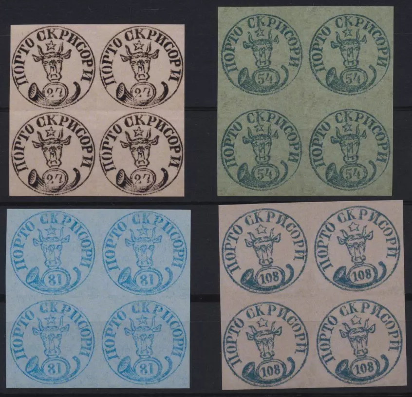

## 🐃 1 🆁 Replica ⏭ Werner

<!-- u:u00918 kind:quad -->

Werner's replicas, or 'Wernerites,' became popular around 2000. Made by a studio in Slovakia, these replicas use various techniques to recreate famous, rare, or expensive stamps. They allow collectors to fill gaps in their collections, with the understanding that they are not originals.
Figure 188: 🐃 1 🆁 Replica ⏭ Werner
