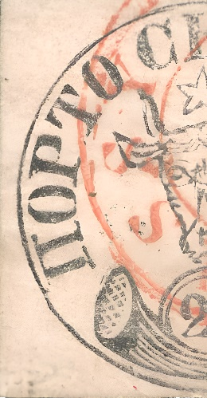
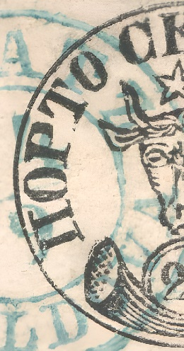
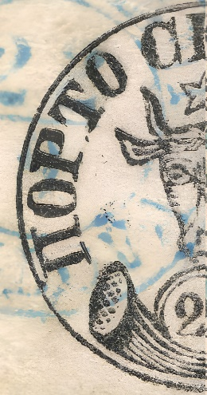
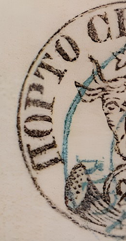

### 27 Parale ПОРТО

<!-- u:u00927 kind:text -->
O1,2	The first O is wider than the second.

<!-- u:u00928 kind:text -->
П	There are several points between the top left of the ridge and the surrounding circle.

<!-- u:u00929 kind:text -->
П	The small left heel is slightly turned to the left.

<!-- u:u00930 kind:text -->
П	The small right heel is slightly curved to the right.

<!-- u:u00931 kind:text -->
P	The bilateral sole is rounded.

<!-- u:u00932 kind:text -->
T	The heel has a dash (point) isolated towards P.

<!-- u:u00933 kind:text -->
T	The foot of T is slightly curved.

<!-- u:u00941 kind:text -->
21345602134560

<!-- u:u00942 kind:table -->

|  | 2134560213456021345602134560 | 21345?6021345?60 |  |
|---|---|---|---|
| ⏭ Figure 196 🔍 | ⏭ Figure 194 🔍 | ⏭ Figure 193 🔍 | ⏭ Figure 197 🔍 |
