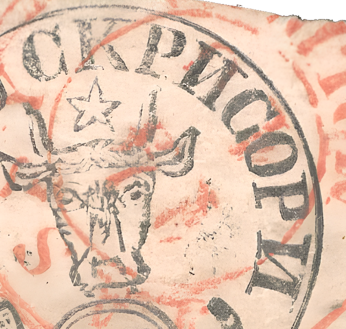
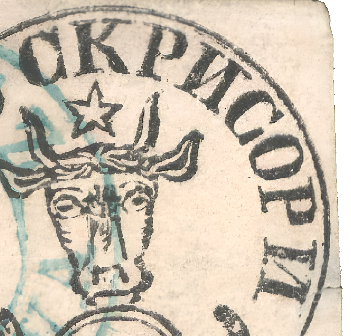
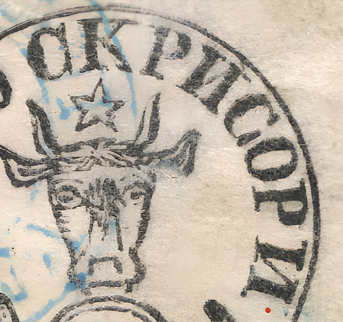
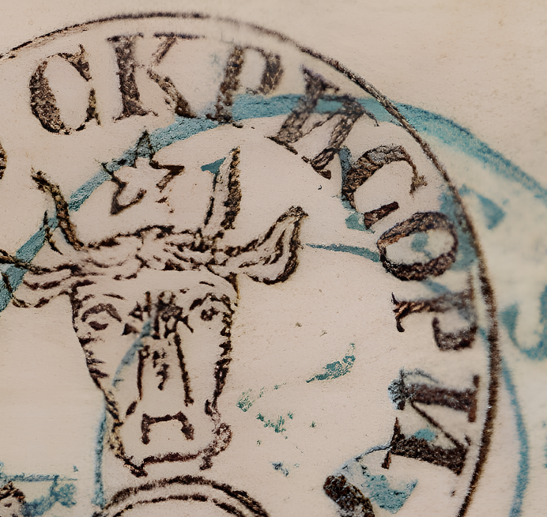

### 27 Parale СКРИСОРИ

<!-- u:u00958 kind:text -->
C1	The peaks are very close, but not touching.

<!-- u:u00959 kind:text -->
K	The left foot has a long heel.

<!-- u:u00960 kind:text -->
K	The upper part of the right arm has a long ridge.

<!-- u:u00961 kind:text -->
K	The right leg is wavy.

<!-- u:u00962 kind:text -->
И1	The inner line ends with a bulge on the left leg.

<!-- u:u00963 kind:text -->
И1	The right leg has a long ridge on the upper side.

<!-- u:u00964 kind:text -->
C2	Resembles a G.

<!-- u:u00965 kind:text -->
P2	The left foot has a visible ridge on the upper part.

<!-- u:u00966 kind:text -->
P2	The front of the foot is slightly curved.

<!-- u:u00967 kind:text -->
И2	The lower part of the inner line is curved towards the left leg.

<!-- u:u00968 kind:text -->
И1,2	И1 is narrower than И2.

<!-- u:u00969 kind:text -->
1412813151617791011141281315161779101114128131516177910111412813151617791011

<!-- u:u00970 kind:quad -->

<!-- u:u00993 kind:quad -->

<!-- u:u01000 kind:text -->
C2	Erinnert an ein G.
