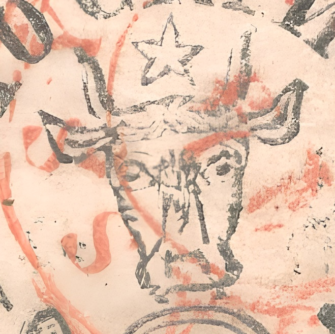
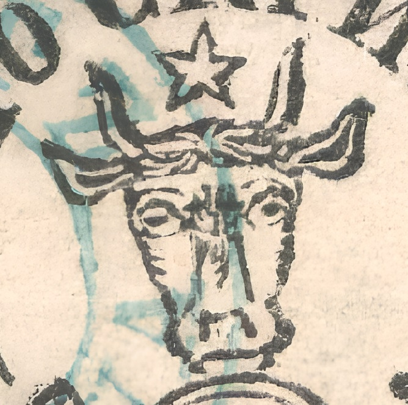
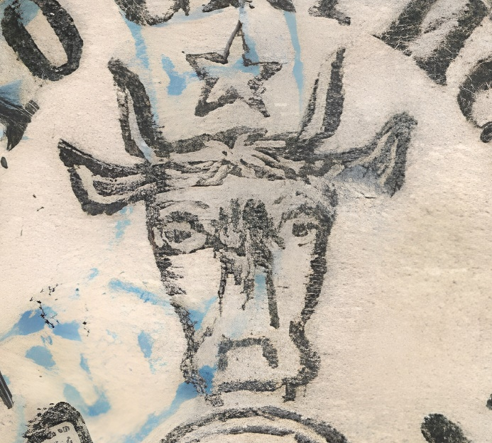
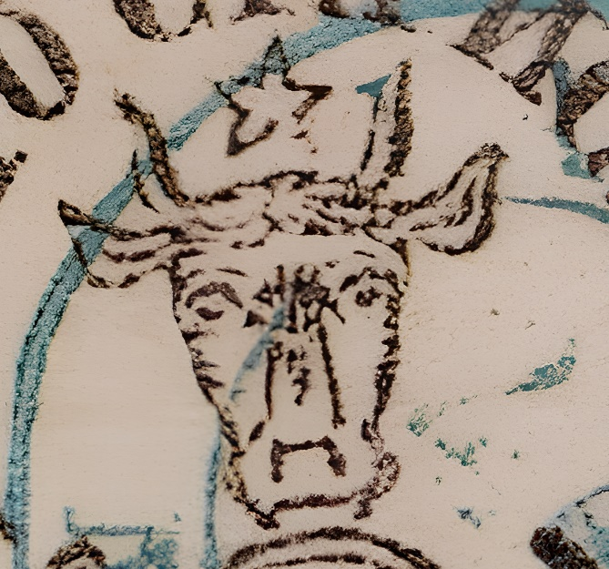

### 27 Parale 🐃

<!-- u:u01006 kind:text -->
Both horns have two lines, a thin one on the left and a thick one on the right.

<!-- u:u01007 kind:text -->
The ear on the right is larger than the ear on the left.

<!-- u:u01008 kind:text -->
The ear on the right has a curved and interrupted (lower) line.

<!-- u:u01009 kind:text -->
Both eyebrows have small thin lines, the one on the left is flatter and the one on the right is more rounded.

<!-- u:u01010 kind:text -->
The iris on the right has a dot.

<!-- u:u01011 kind:text -->
The iris on the left has intersecting lines

<!-- u:u01012 kind:text -->
The snout has a curved line on the left.

<!-- u:u01013 kind:text -->
The snout has an interrupted line on the right.

<!-- u:u01014 kind:text -->
The nostrils reseble a letter C (with 3 segments) facing downards.

<!-- u:u01015 kind:text -->
The lower lip is not joined to the postal horn as is the case with the other stamps in this issue.

<!-- u:u01016 kind:text -->
ABCCAABBDFFEGGHIHABCCAABBDFFEGGHIHDD

<!-- u:u01017 kind:quad -->

<!-- u:u01022 kind:text -->
Irisul din dreapta are un punct.

<!-- u:u01038 kind:text -->
ABCCAABBDFFEGGHIHABCCAABBDFFEGGHIH

<!-- u:u01039 kind:quad -->

DD
