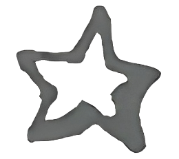
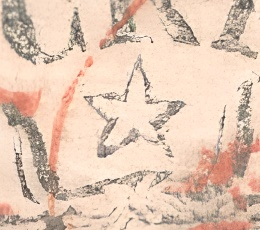
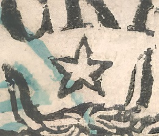
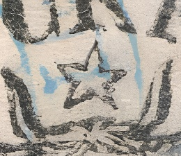
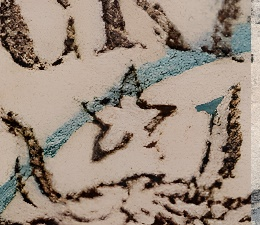

### 27 Parale ⭐

<!-- u:u01051 kind:quad -->
The star has five points, ten segments and is slightly tilted towards the right. Segments 9 and 2 that connect the two upper points are not horizontal. The top point of the star is slightly inclined towards the tip of letter K’s foot . Segments 3, 4, and 6 appear thicker.

<!-- u:u01052 kind:table -->

| 1234567891012345678910 |  |  |  |  |
|---|---|---|---|---|
| ⏭ 📖 Kiriac 1974 Fig.104 🔍 | ⏭ Figure 196 🔍 | ⏭ Figure 194 🔍 | ⏭ Figure 193 🔍 | ⏭ Figure 197 🔍 |

<!-- u:u01053 kind:table -->
| L'étoile a cinq pointes, dix segments et est légèrement inclinée vers la droite. Les segments 9 et 2 qui relient les deux pointes supérieures ne sont pas horizontaux. La pointe supérieure de l'étoile est légèrement inclinée vers l'extrémité du pied de la lettre K. Les segments 3, 4 et 6 semblent plus épais. | Der Stern hat fünf Punkte, zehn Segmente und ist leicht nach rechts geneigt. Die Segmente 9 und 2, die die beiden oberen Spitzen verbinden, sind nicht horizontal. Die obere Spitze des Sterns ist leicht zur Spitze des Fußes von Buchstabe K geneigt. Die Segmente 3, 4 und 6 erscheinen dicker. |
|---|---|
