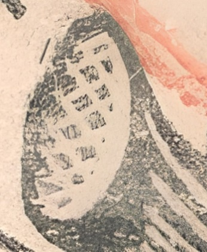
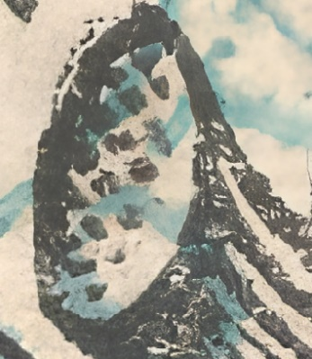
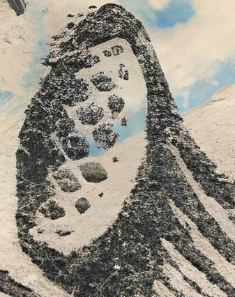
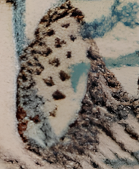
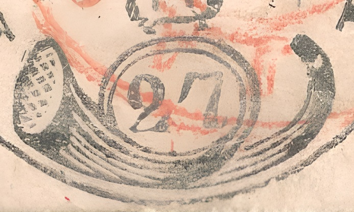
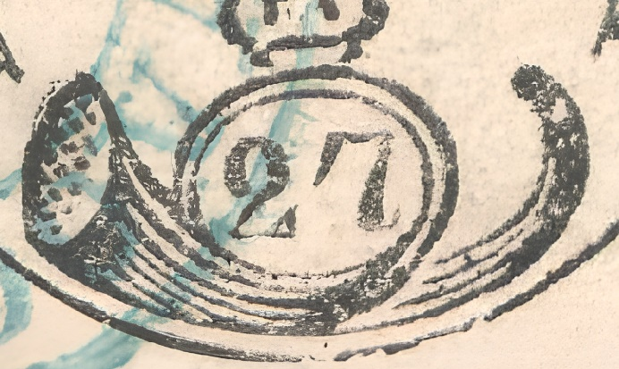
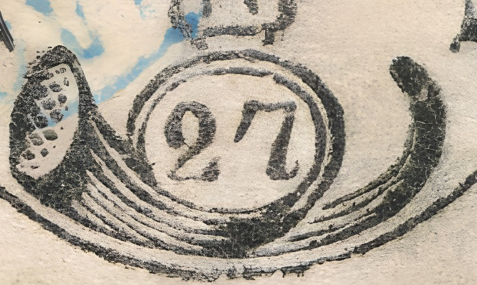
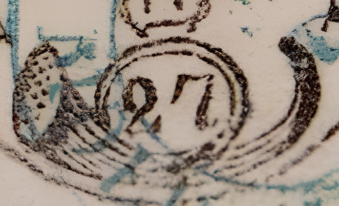

### 27 Parale 📯

<!-- u:u01055 kind:quad -->
The postal horn has its pavilion shaded with clear points (squares) arranged on six diagonals, leaving a white space to the right like a crescent moon.

<!-- u:u01056 kind:table -->

|  |  |  |  |
|---|---|---|---|
| ⏭ Figure 196 🔍 | ⏭ Figure 194 🔍 | ⏭ Figure 193 🔍 | ⏭ Figure 197 🔍 |

<!-- u:u01057 kind:table -->
| Le pavillon du cor postal est ombré de points clairs (carrés) disposés sur six diagonales, laissant un espace blanc à droite comme un croissant de lune. | Das Posthorn hat einen schattierten Pavillon mit klaren Punkten (Quadraten), die auf sechs Diagonalen angeordnet sind, wobei rechts ein weißer Raum wie eine Mondsichel verbleibt. |
|---|---|

<!-- u:u01058 kind:quad -->

The first three upper lines of the postal horn are thicker on the left side.
The leg of „2” does not touch the tip. 
The heel of „2” is triangular. 
The lip does not touch the post horn.
"7" has an obtuse angle at the top left.
"7" has a slightly curved ridge. 
The small heel of "7" is curved upwards.
The three top lines on the right side do not touch the loop.
There is a dot on the dark mouthpiece.
Below "27", the bottom of the loop is a thin line.

ixiiiiiivviviiviiiixixiiiiiivviviiviiiixvixiiiiiivviviiviiiixixiiiiiivviviiviiiixv

<!-- u:u01059 kind:text -->
ixiiiiiivviviiviiiixvixiiiiiivviviiviiiixvixiiiiiivviviiviiiixvixiiiiiivviviiviiiixv

<!-- u:u01060 kind:quad -->

