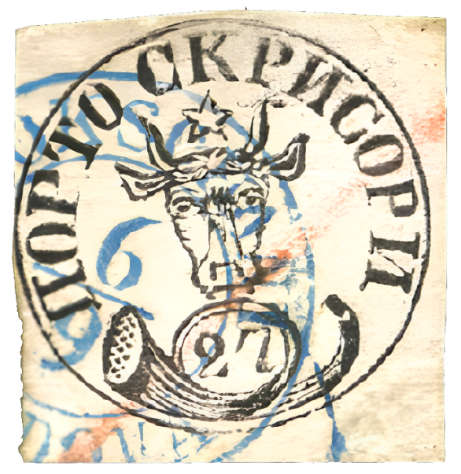

### 27 Parale ⨀ M1 🌍 Focşani (Fokschani) 📅 6/9

<!-- u:u01072 kind:text -->
1858-09-06 J📅G 1858-09-18

<!-- u:u01073 kind:text -->
Saturday

<!-- u:u01074 kind:figure -->

*Figure 192: 27 Parale ⨀ M1 🌍 Focşani (Fokschani) 📅 6/9*

<!-- u:u01076 kind:text -->
📜 JF.Brun

<!-- u:u01077 kind:text -->
📖 David Feldman 📅 2013-09-27 ⏭ Lot 70794

<!-- u:u01078 kind:text -->
💰 € 7`000 (not sold)
