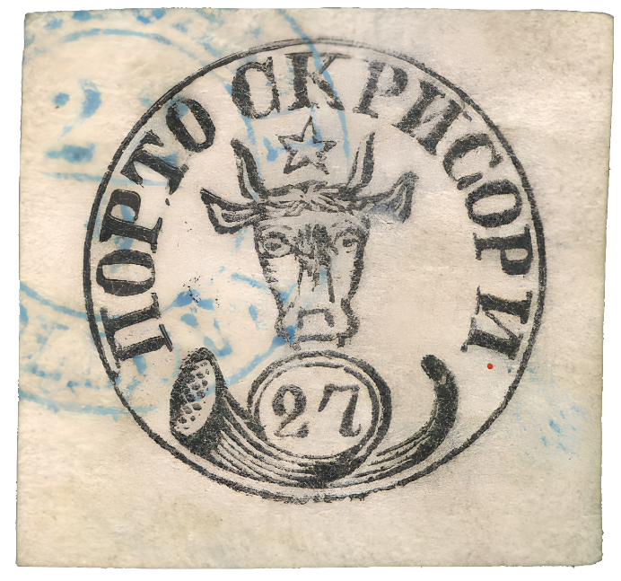
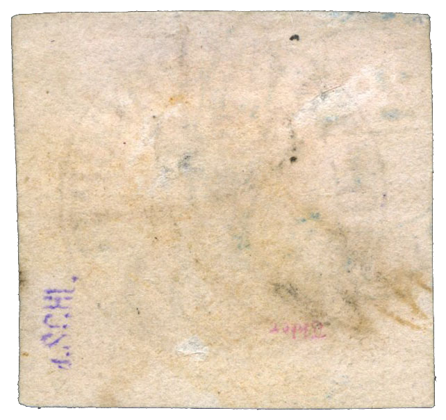

### 27 Parale ⨀ M1 🌍 Focşani (Fokschani) 📅 22/9

<!-- u:u01080 kind:text -->
1858-09-22 J📅G 1858-10-04

<!-- u:u01081 kind:text -->
Monday

<!-- u:u01082 kind:table -->

|  |  |
|---|---|

<!-- u:u01084 kind:text -->
✍ J. Schlesinger

<!-- u:u01085 kind:text -->
📜 Holcombe 📅 1998 ⏭ Figure 201, p.254

<!-- u:u01086 kind:text -->
📖 David Feldman 📅 2022-12-08 ⏭ Lot 60359

<!-- u:u01087 kind:text -->
💰 € 4`000 (sold) 📖 MI € 12`000
