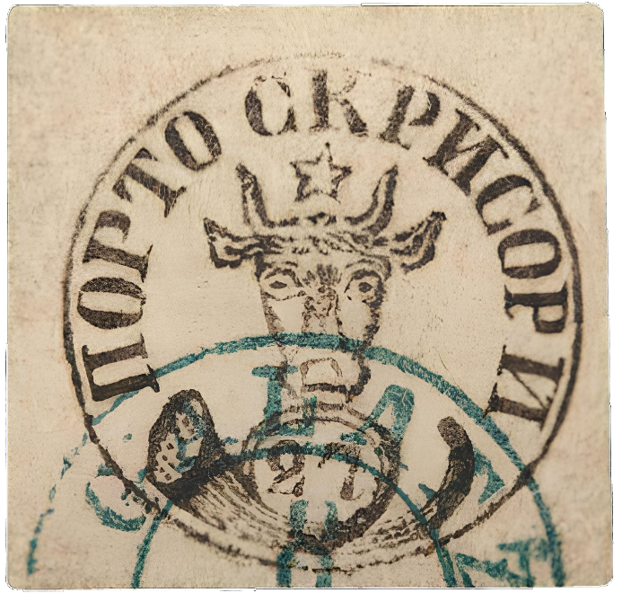

### 27 Parale ⨀ M1 🌍 Galaţi (Galatz) 8/? 📅 1858

<!-- u:u01098 kind:figure -->

*Figure 195: 27 Parale ⨀ M1 🌍 Galaţi (Galatz) 8/? 📅 1858*

<!-- u:u01100 kind:text -->
⏭ Artmark 📅 2015-09-29

<!-- u:u01101 kind:text -->
💰 € 10`000 (starting bid)
