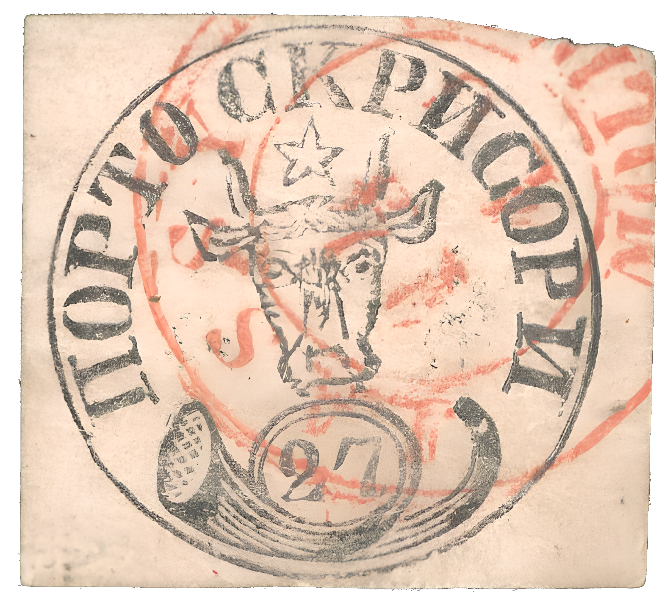
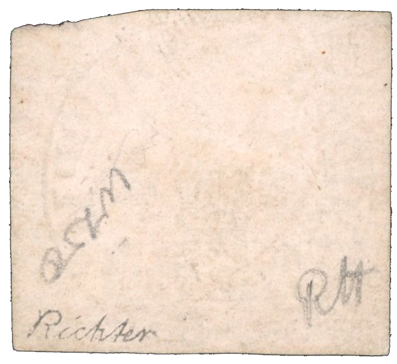

### 27 Parale ⨀ M1 🌍 Iaşi (Jassy) 📅 14/10

<!-- u:u01103 kind:text -->
1858-10-14 J📅G 1858-10-26

<!-- u:u01104 kind:text -->
Tuesday

<!-- u:u01105 kind:table -->

|  |  |
|---|---|

<!-- u:u01107 kind:text -->
✍ Richter

<!-- u:u01108 kind:text -->
📜 Bloch 📅 1983 ⏭ Figure 203, p.254

<!-- u:u01109 kind:text -->
📜 Gmach 📅 2022 ⏭ Figure 204, p.254

<!-- u:u01111 kind:text -->
⏭ Robson Lowe 📅 1983-04

<!-- u:u01112 kind:text -->
📖 David Feldman 📅 2022-12-08 ⏭ Lot 60360

<!-- u:u01113 kind:text -->
💰 € 6000 (sold) 📖 MI € 15`000
