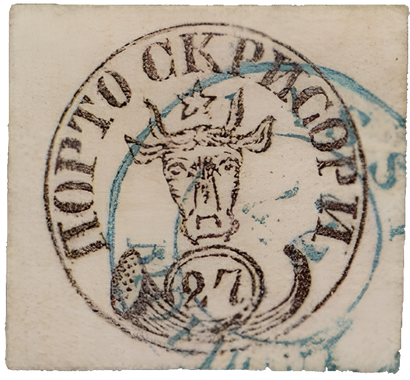

### 27 Parale ⨀ M1 🌍 Iaşi (Jassy) 📅 1858-??-22

<!-- u:u01115 kind:figure -->

*Figure 197: 27 Parale ⨀ M1 🌍 Iaşi (Jassy) 📅 1858-??-22*

<!-- u:u01117 kind:text -->
✍ E.Diena ✍ A.Diena

<!-- u:u01120 kind:text -->
📖 David Feldman 📅 2014-12-06 ⏭ Lot 52501

<!-- u:u01121 kind:text -->
💰 € 10`000 (sold)
