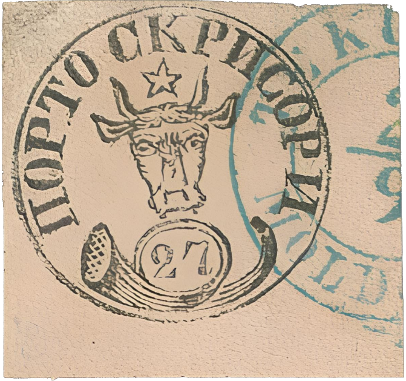
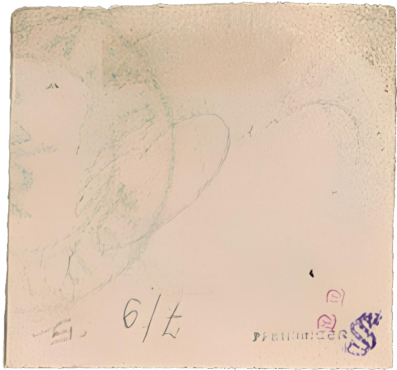

### 27 Parale ⨀ M1 🌍 Tecuci (Tekutsch) 📅 2/9

<!-- u:u01123 kind:text -->
1858-09-02 J📅G 1858-09-14

<!-- u:u01124 kind:text -->
Tuesday

<!-- u:u01125 kind:table -->

|  |  |
|---|---|

<!-- u:u01129 kind:text -->
📖 Corinphila 186 ⏭ Lot 1114

<!-- u:u01130 kind:text -->
💰 CHF 5000 (not sold) 📖

<!-- u:u01131 kind:text -->
📖 MI € 17`000
