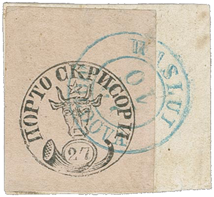

### 27 Parale △ ⨀ M1 🌍 Vaslui (Waslui) 📅 22/10

<!-- u:u01133 kind:text -->
1858-10-22 J📅G 1858-11-03

<!-- u:u01134 kind:text -->
Wednesday

<!-- u:u01136 kind:text -->
Datum invertiert

<!-- u:u01137 kind:figure -->

*Figure 199: 27 Parale △ ⨀ M1 🌍 Vaslui (Waslui) 📅 22/10*

<!-- u:u01139 kind:text -->
✍ Friedl

<!-- u:u01142 kind:text -->
📖 Corinphila 179 ⏭ Lot 5018 💰 CHF 23`000 (sold)

<!-- u:u01143 kind:text -->
📖 MI € 17`000 📖 SC $ 25`000
