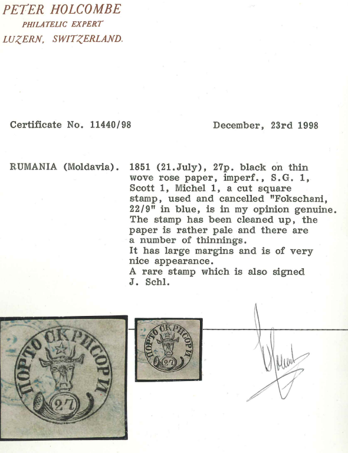
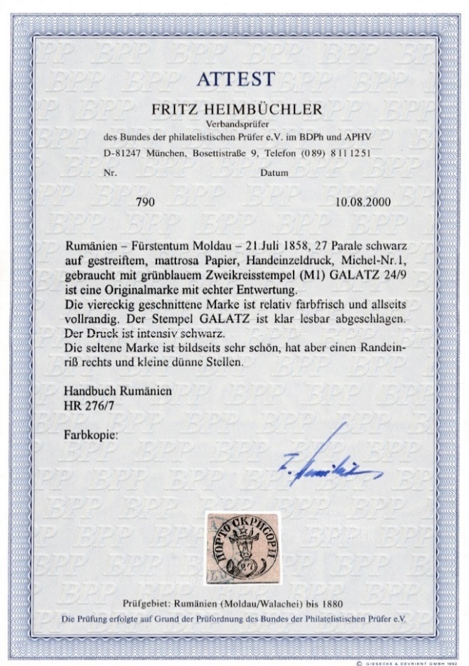
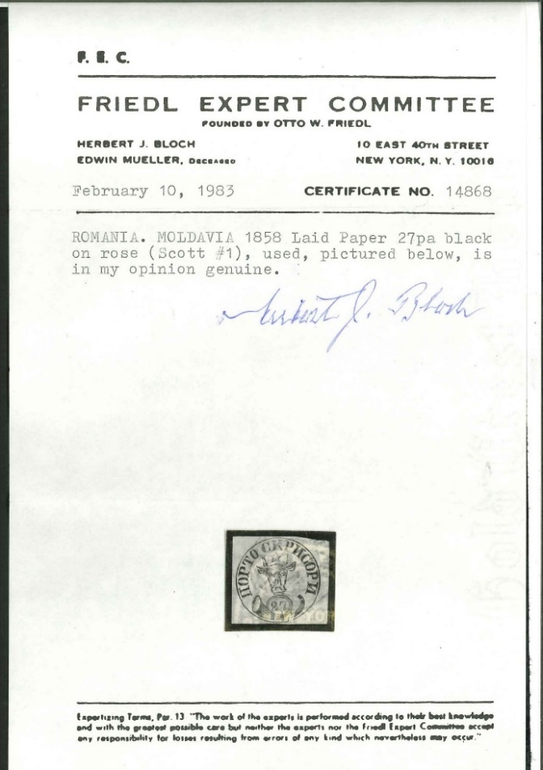
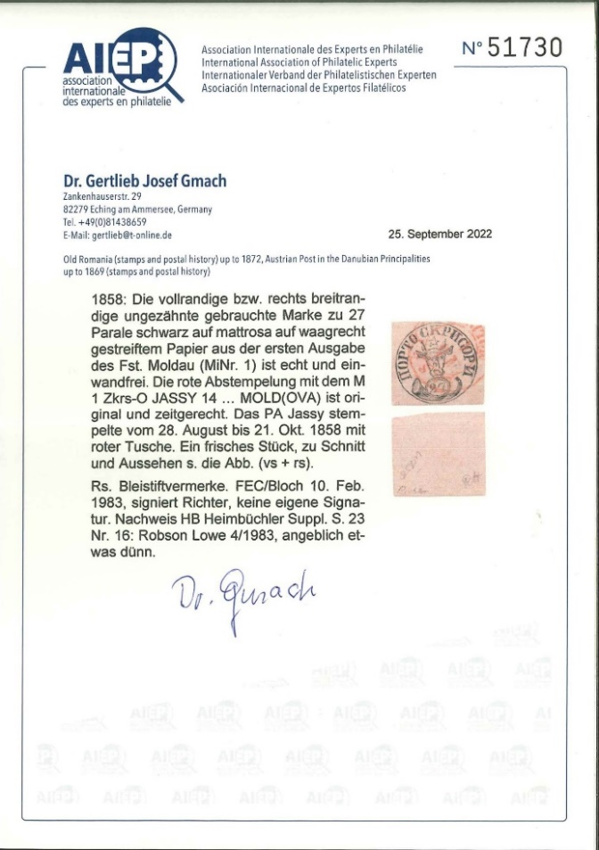
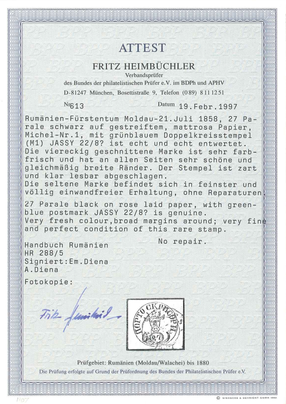
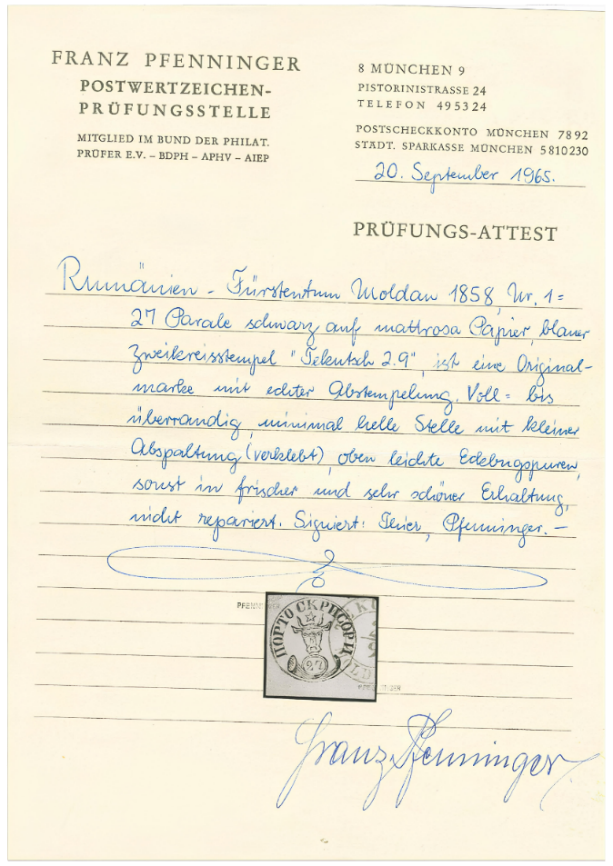
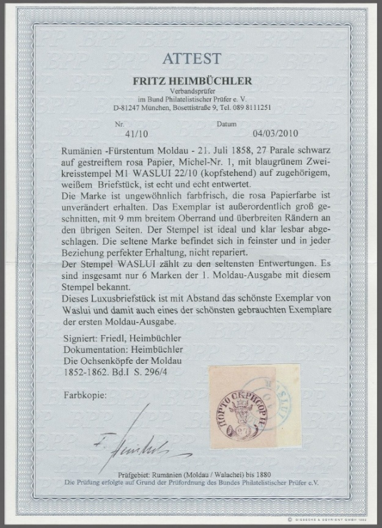

## 27 Parale 📜

<!-- u:u01150 kind:quad -->

Figure 201: 📜 Holcombe 📅 1998
⏭ Figure 193, p.250

<!-- u:u01151 kind:table -->

| Figure 205: 📜 Heimbüchler 📅 1997 ⏭ Figure 197, p.252 | Figure 206: 📜 Pfenninger 📅 1965 ⏭ Figure 198, p.253 |
|---|---|
| Figure 207: 📜 Heimbüchler 📅 2010 ⏭ Figure 199, p.253 |  |
