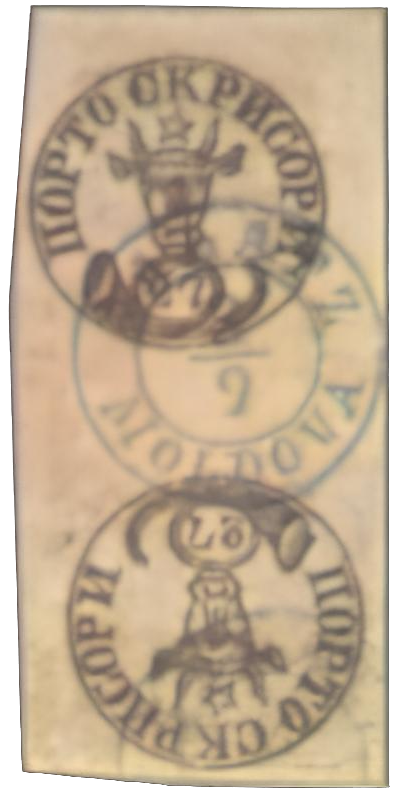
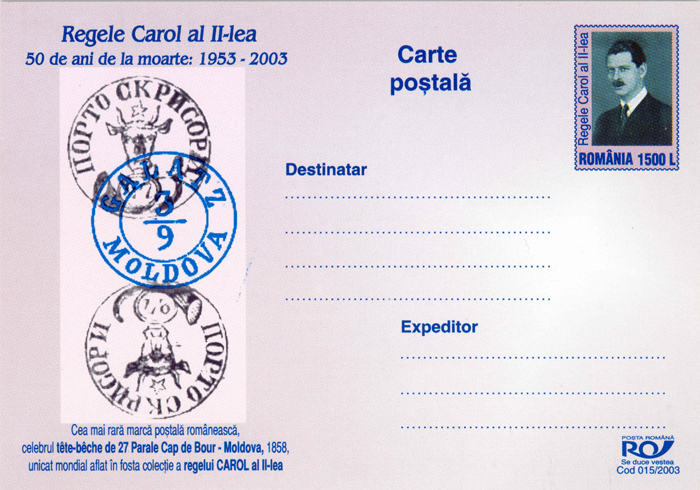

## 27 Parale ⨀ M1 🌍 Galaţi (Galatz) 📅 3/9

<!-- u:u01153 kind:text -->
1858-09-03 J📅G 1858-09-15

<!-- u:u01154 kind:text -->
Wednesday

<!-- u:u01155 kind:quad -->
The pair of 27 Parale Tête-bêche stamps, which was part of the impressive stamp collection of King Carol II of Romania, is one of the rarest in the world. It was last seen in public in 1950 at the London International Stamp Exhibition. After King Charles II was forced into exile, it is believed that he used some of his valuable stamps, including this pair, to finance his new life abroad. The exact whereabouts of these stamps became a mystery after his death in 1953. The famous Tête-Bêche pair could be part of a private collection nowadays.

<!-- u:u01156 kind:figure -->

*Figure 208: 27 Parale ⨀ M1 🌍 Galaţi (Galatz) 📅 3/9*

<!-- u:u01158 kind:figure -->

*Figure 209: Postcard*

<!-- u:u01163 kind:text -->
1937 📅 Arthur Hind  Carol II

<!-- u:u01164 kind:text -->
1950 📅 Carol II 🌍 London
