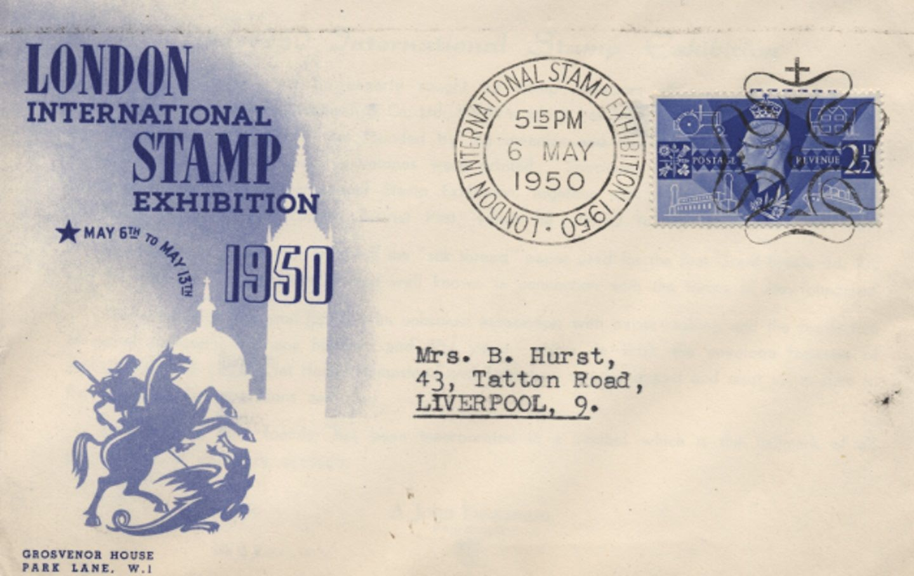
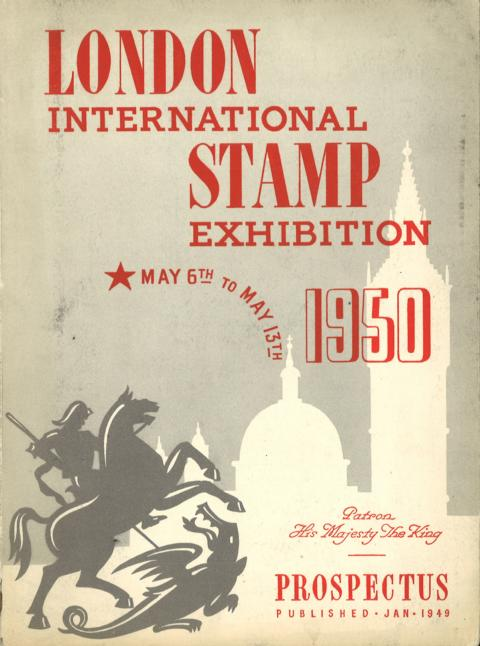
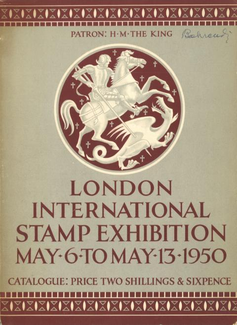
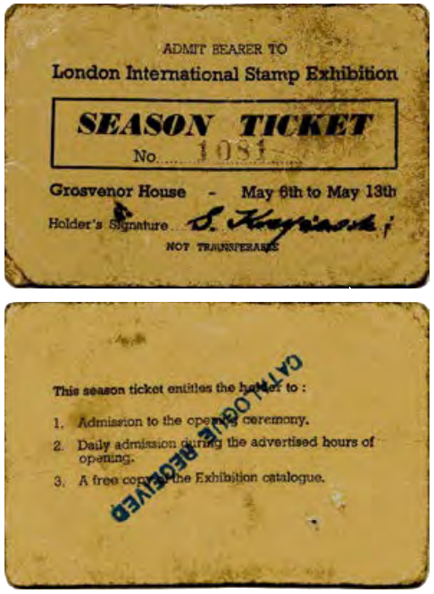
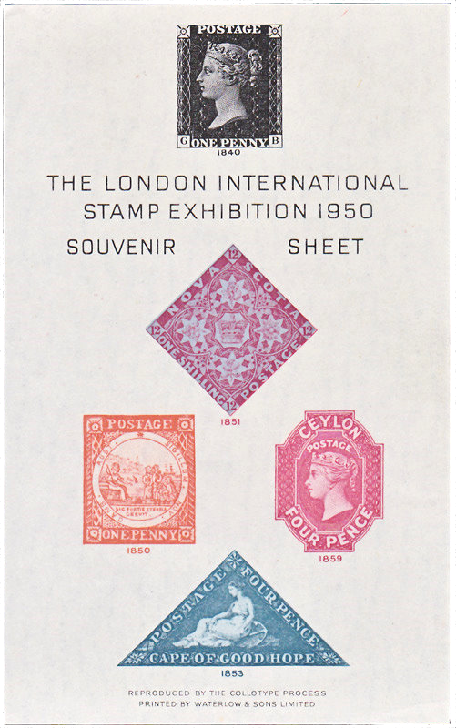
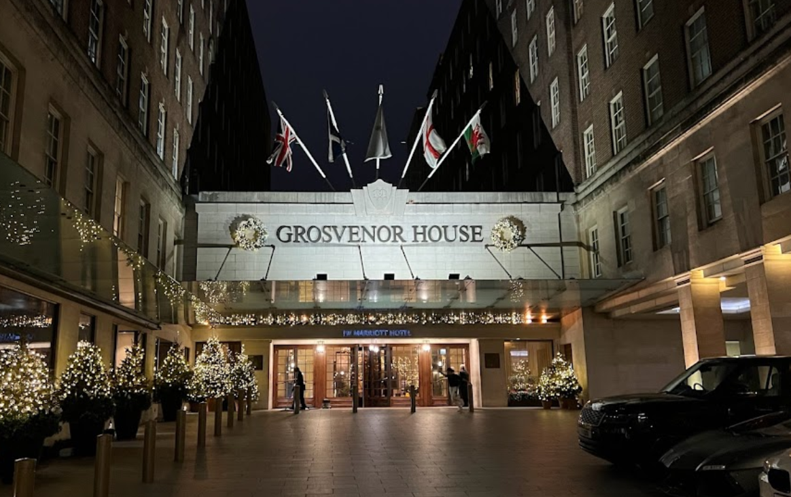
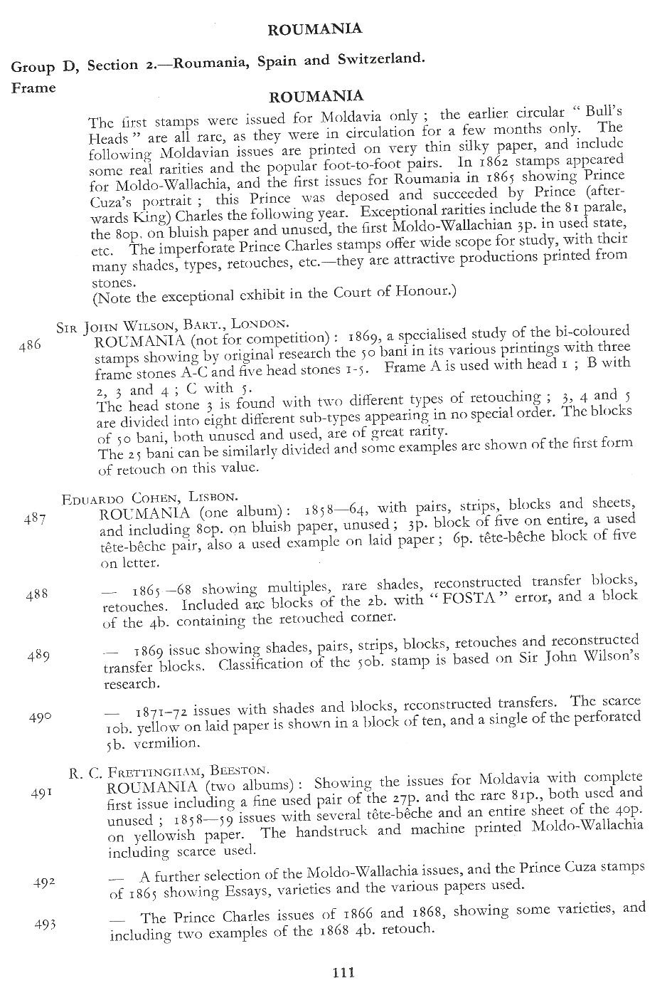

### International Stamp Exhibition 🌍 London 📅 1950-05-06..13

<!-- u:u01166 kind:figure -->

*Figure 210: Souvenir cover*

<!-- u:u01168 kind:figure -->

*Figure 211: Prospect*

<!-- u:u01170 kind:figure -->

*Figure 212: Catalogue*

<!-- u:u01172 kind:figure -->

*Figure 213: Ticket*

<!-- u:u01174 kind:figure -->

*Figure 214: Souvenir Sheet*

<!-- u:u01176 kind:figure -->

*Figure 215: 🌍 Grosvenor House 📅 2022*

<!-- u:u01178 kind:figure -->

*Figure 216: Catalogue, p.111 ⏭ Figure 212*
