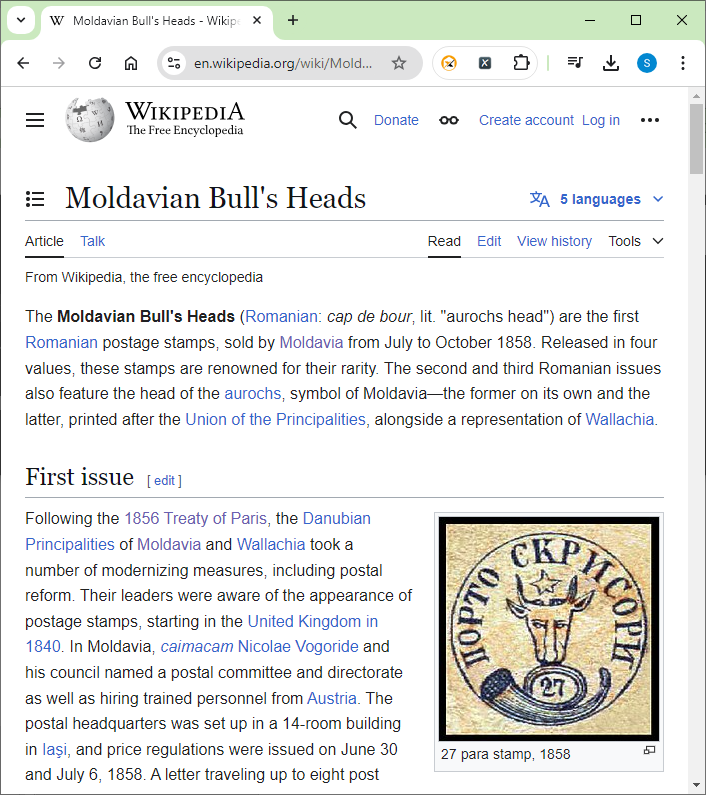
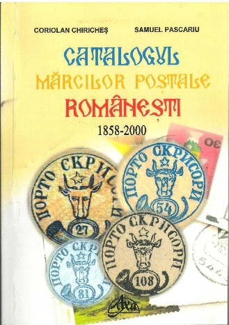
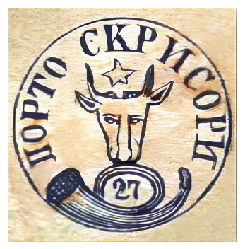

### 27 Parale 🆁 Replica ⏭ „Wikipedia-style”

<!-- u:u01193 kind:figure -->

*Figure 221: 27 Parale 🆁 Replica ⏭ „Wikipedia-style”*

<!-- u:u01195 kind:table -->

| Figure 222: 27 Parale 🆁 Replica ⏭ „Wikipedia-style” | 📖 Catalog 2024 | Figure 223: 27 Parale 🆁 Replica ⏭ „Wikipedia-style” |
|---|---|---|
