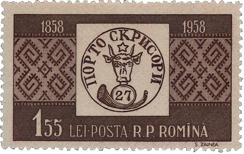
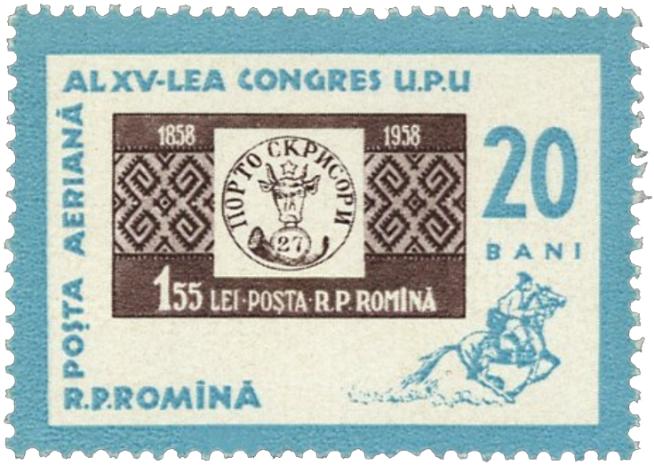
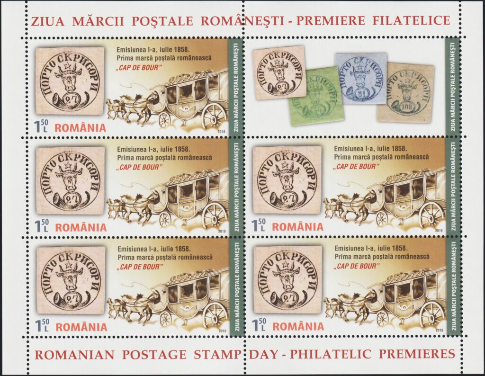
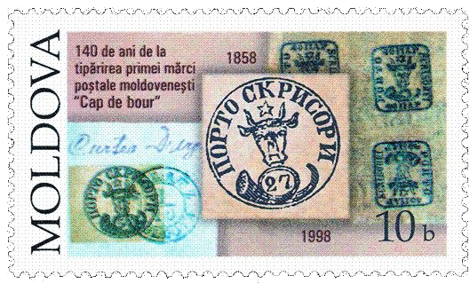
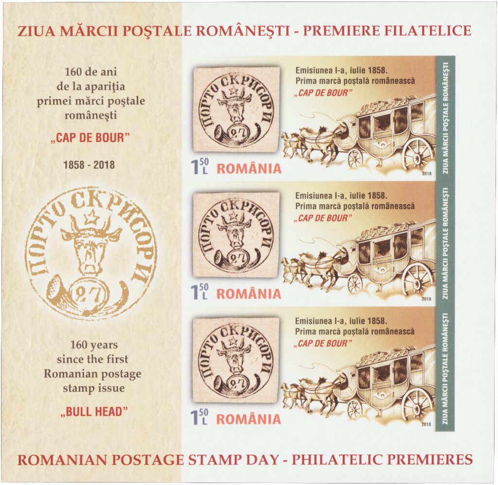
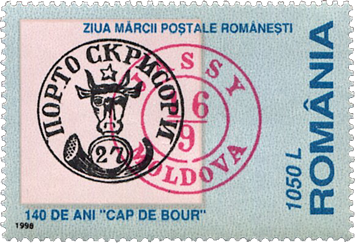
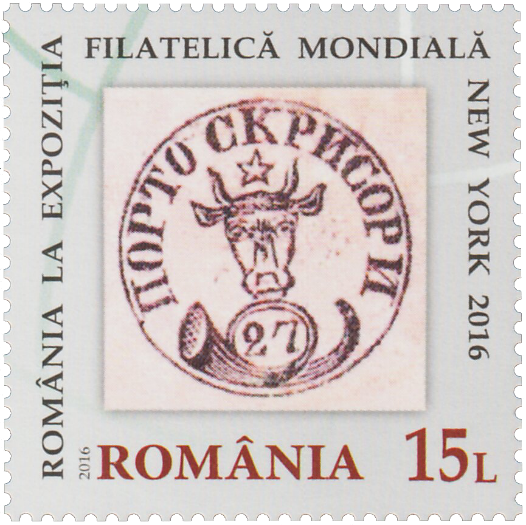
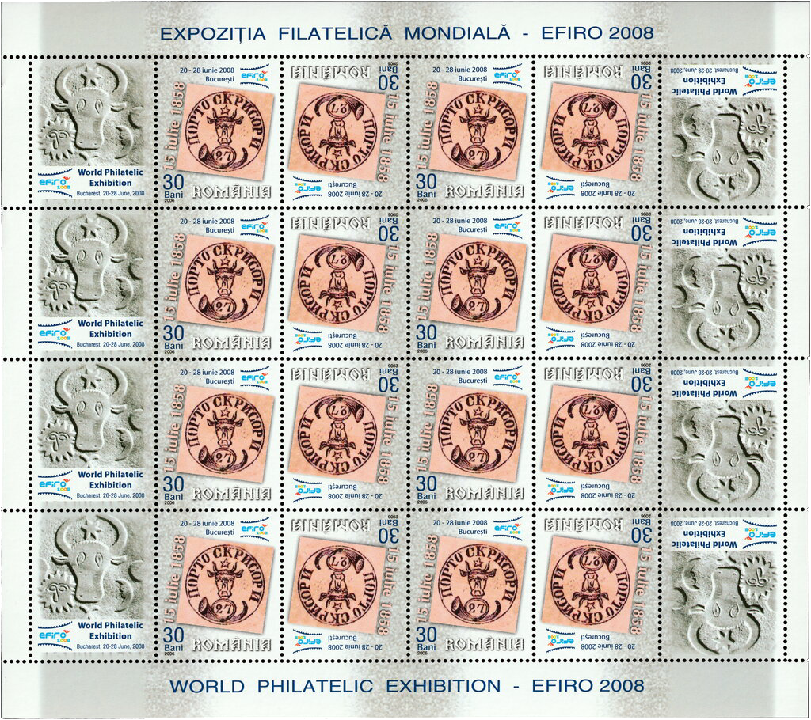
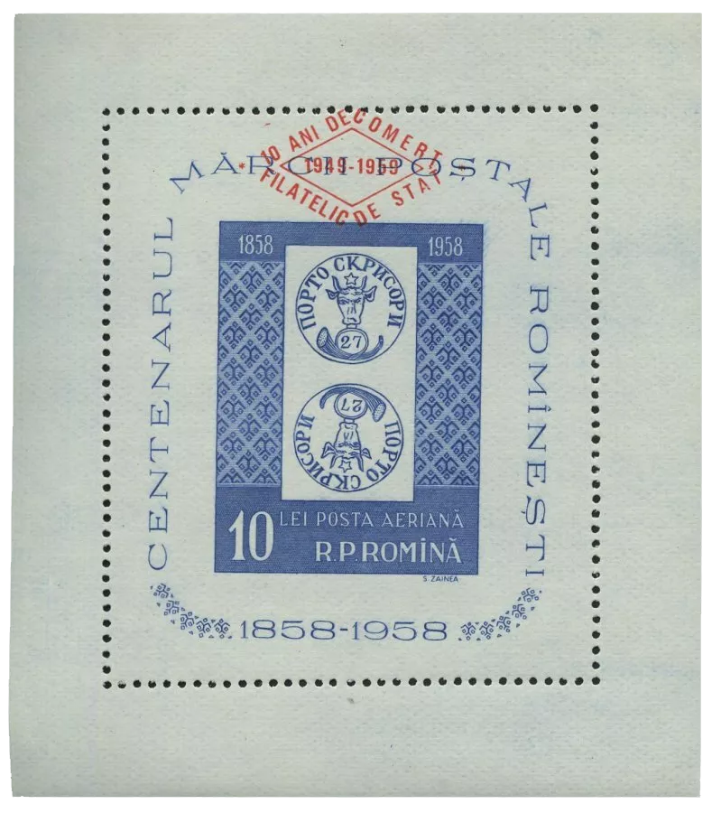
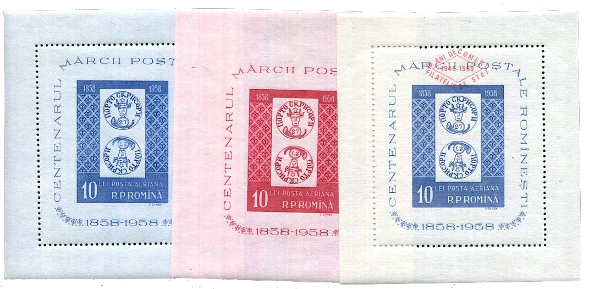

## 27 Parale Commemoration

<!-- u:u01208 kind:quad -->

Figure 226: 📖 MI RO 1754

<!-- u:u01209 kind:figure -->

*Figure 228: 📖 MI RO 7408AKB*

<!-- u:u01211 kind:figure -->

*Figure 229: 📖 MI MD 291*

<!-- u:u01213 kind:figure -->

*Figure 230: 📖 MI RO 7408BI KB*

<!-- u:u01215 kind:quad -->

Figure 231: 📖 MI RO 5339

<!-- u:u01216 kind:figure -->

*Figure 233: 📖 MI RO 6118*

<!-- u:u01218 kind:figure -->

*Figure 234: 📖 MI RO Block 42*

<!-- u:u01220 kind:figure -->

*Figure 235: 📖 MI RO Block 40, 41, 42*
