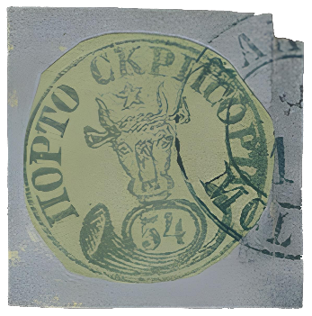
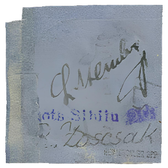

### 54 Parale ✂ △ ⨀ M1 🌍 Bacău (Bakeu) 📅 8/10

<!-- u:u01247 kind:text -->
1858-10-08 J📅G 1858-10-20

<!-- u:u01248 kind:text -->
Wednesday

<!-- u:u01249 kind:table -->

|  |  |
|---|---|

<!-- u:u01254 kind:text -->
⏭ Shanahan sale 70, lot 577 📅 1958-07

<!-- u:u01255 kind:text -->
⏭ Shanahan sale 77, lot 232 📅 1958-11

<!-- u:u01258 kind:text -->
📖 Corinphila 182 ⏭ Lot 1706 💰 CHF 1`600
