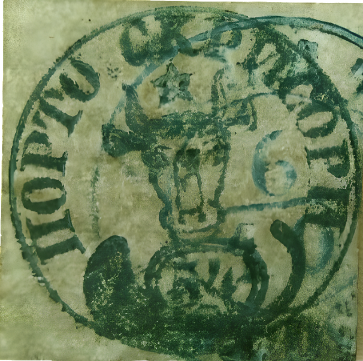

### 54 Parale ⨀ M1 🌍 Galaţi (Galatz) 📅 6/10

<!-- u:u01260 kind:text -->
1858-10-06 J📅G 1858-10-18

<!-- u:u01261 kind:text -->
Monday

<!-- u:u01262 kind:figure -->

*Figure 239: 54 Parale ⨀ M1 🌍 Galaţi (Galatz) 📅 6/10*

<!-- u:u01264 kind:text -->
⨀ C1 ⬇ (?)
