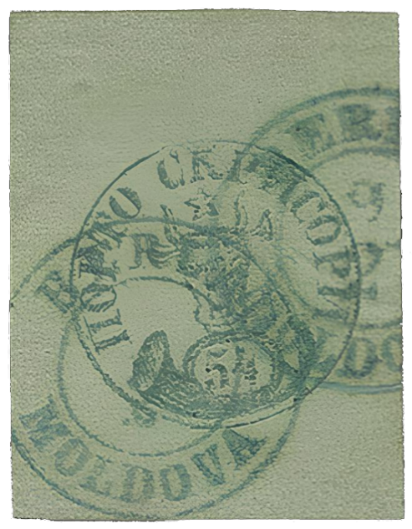

### 54 Parale ⨀ M1 🌍 Bârlad (Berlad) 📅 9/2

<!-- u:u01275 kind:text -->
1858-09-02 J📅G 1858-09-14

<!-- u:u01276 kind:text -->
Tuesday

<!-- u:u01277 kind:figure -->

*Figure 241: 54 Parale ⨀ M1 🌍 Bârlad (Berlad) 📅 9/2*

<!-- u:u01279 kind:text -->
✍ A.Diena

<!-- u:u01280 kind:text -->
📜 Diena 📅 1964 ⏭ Figure 251, p.277

<!-- u:u01284 kind:text -->
⏭ Collection John Lek 📅 1959-06

<!-- u:u01285 kind:text -->
⏭ Corinphila 179 ⏭ Lot 5019

<!-- u:u01286 kind:text -->
💰 10`000 CHF (starting bid, not sold)
