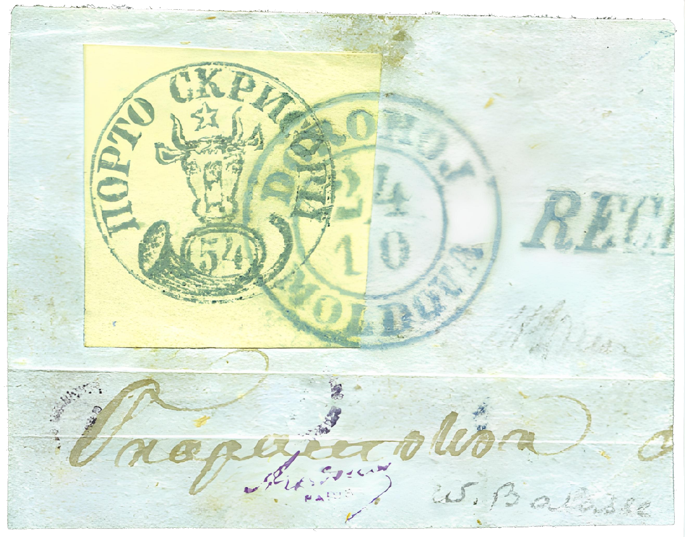

### 54 Parale △ ⨀ M1 🌍 Dorohoi (Dorohoj) ⨀ C1 📅 24/10

<!-- u:u01288 kind:text -->
1858-10-24 J📅G 1858-11-05

<!-- u:u01289 kind:text -->
Friday

<!-- u:u01290 kind:figure -->

*Figure 242: 54 Parale △ ⨀ M1 🌍 Dorohoi (Dorohoj) ⨀ C1 📅 24/10*

<!-- u:u01295 kind:text -->
⏭ David Feldman 2013 ⏭ Lot 70798 💰 € 14`000
