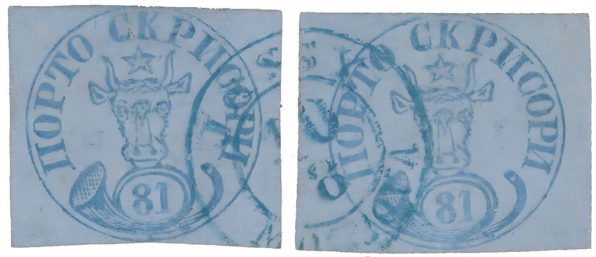

### 81 Parale ⨀ M1 🌍 Iaşi (Jassy) 📅 10/8

<!-- u:u01320 kind:text -->
1858-08-10 J📅G 1858-08-22

<!-- u:u01321 kind:text -->
Sunday

<!-- u:u01322 kind:figure -->

*Figure 253: 81 Parale ⨀ M1 🌍 Iaşi (Jassy) 📅 10/8*

<!-- u:u01324 kind:text -->
⬆

<!-- u:u01325 kind:text -->
✍ Stanley Gibbons

<!-- u:u01329 kind:text -->
⬆

<!-- u:u01330 kind:text -->
📜 Albert Diena 📅 1966, submitted by R. Mondolfo

<!-- u:u01331 kind:text -->
📜 Friedl 📅 1953, submitted by R. Mondolfo

<!-- u:u01335 kind:text -->
⏭ Corinphila 179 📅 2013 ⏭ Lot 5024 💰 CHF 75`000 (starting bid, not sold)
