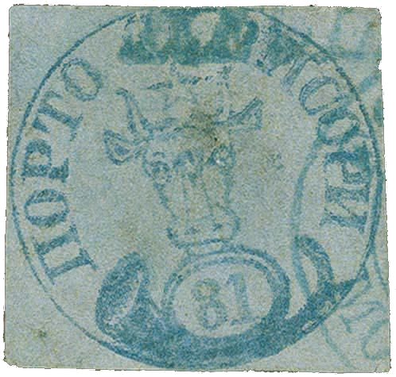
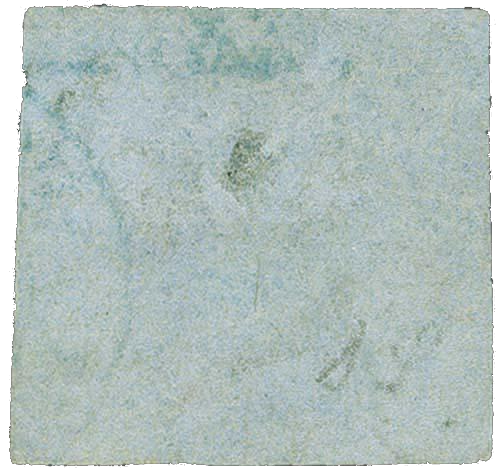

### 81 Parale ✾ ⨀ C1 ⨀ M1 🌍 Focşani (Fokschani)

<!-- u:u01348 kind:table -->

|  |  |
|---|---|

<!-- u:u01351 kind:text -->
📜 Albert Diena 📅 1971 ⏭, p.

<!-- u:u01352 kind:text -->
Provenance: Hamers 📅 1937-05

<!-- u:u01353 kind:text -->
⏭ Corinphila 328 📅 2024 ⏭ Lot 6129 💰CHF 3`000 (starting bid) 💰CHF 14`500 (hammer price)
