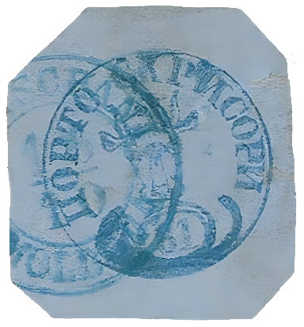
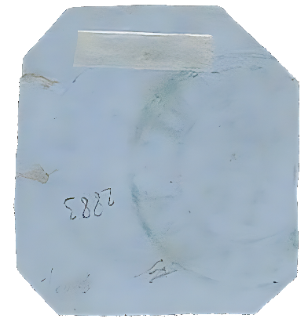

### 81 Parale ✂ ⨀ M1 🌍 Focşani (Fokschani) 16/10

<!-- u:u01355 kind:text -->
1858-10-16 J📅G 1858-10-28

<!-- u:u01356 kind:text -->
Thursday

<!-- u:u01357 kind:table -->

|  |  |
|---|---|

<!-- u:u01362 kind:text -->
⏭ Corinphila 77 📅 1988-09 ⏭ Lot 2883

<!-- u:u01363 kind:text -->
⏭ Huys-Berlingen 📅 1992
