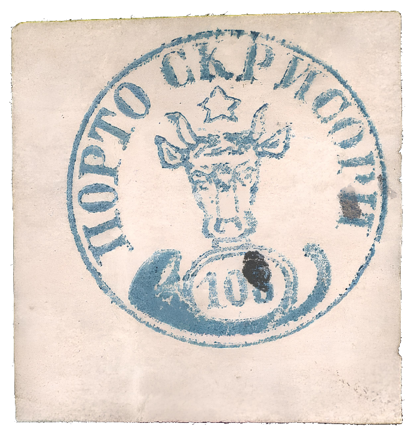
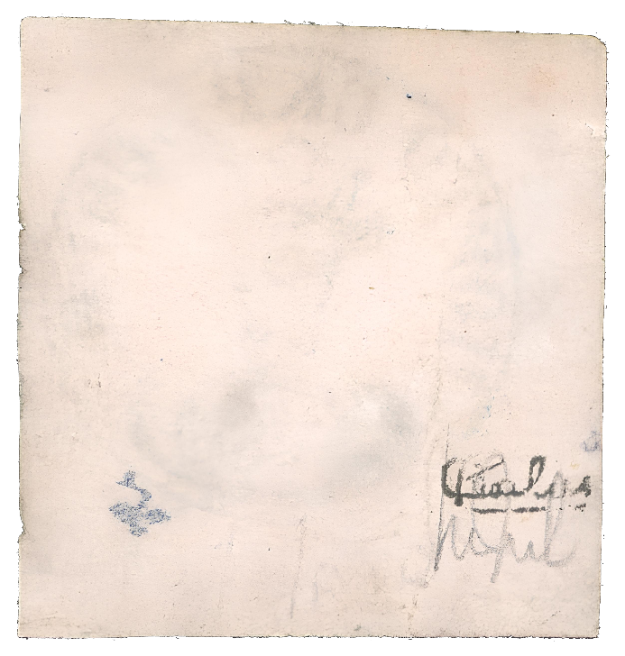

### 108 Parale ✳

<!-- u:u01400 kind:table -->

|  |  |
|---|---|

<!-- u:u01401 kind:text -->
Figure 261: 108 Parale ✳

<!-- u:u01403 kind:text -->
📜 Gmach 📅 2022  ⏭ Figure 265, p.290

<!-- u:u01404 kind:text -->
⏭ Robson Lowe 📅 1969-05

<!-- u:u01405 kind:text -->
⏭ Galeria Filatelica 📅 1987-02

<!-- u:u01408 kind:text -->
⏭ 📖 David Feldman 📅 2022 ⏭ Lot 60366 💰 10`000 CHF (starting bid, not sold)
