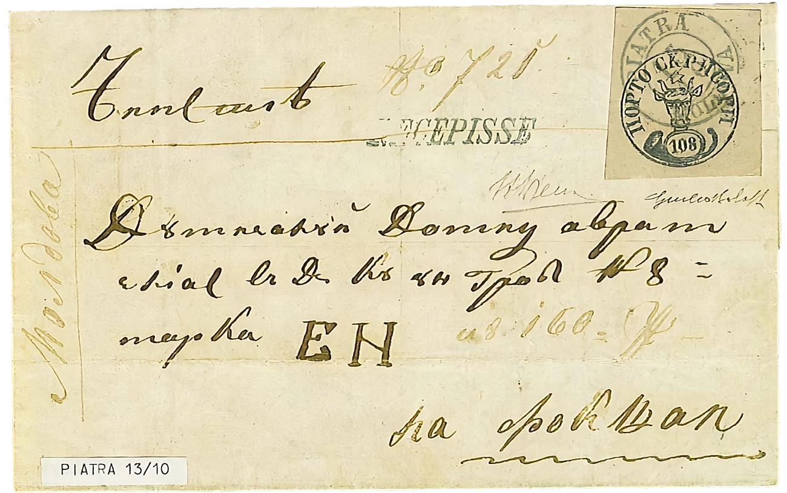

### 108 Parale ✉ ⨀ C1 ⨀ M1 🌍 Piatra Neamţ (Piatra) 📅 13/10

<!-- u:u01424 kind:figure -->

*Figure 264: 108 Parale ✉ ⨀ C1 ⨀ M1 🌍 Piatra Neamţ (Piatra) 📅 13/10*

<!-- u:u01429 kind:text -->
⏭ Burrus 📅 1962

<!-- u:u01430 kind:text -->
⏭ Tomasini 📅 1969

<!-- u:u01431 kind:text -->
⏭ David Feldman 📅 2006 ⏭ Lot 20020 💰 40`000 – 60`000 € (starting bid)
