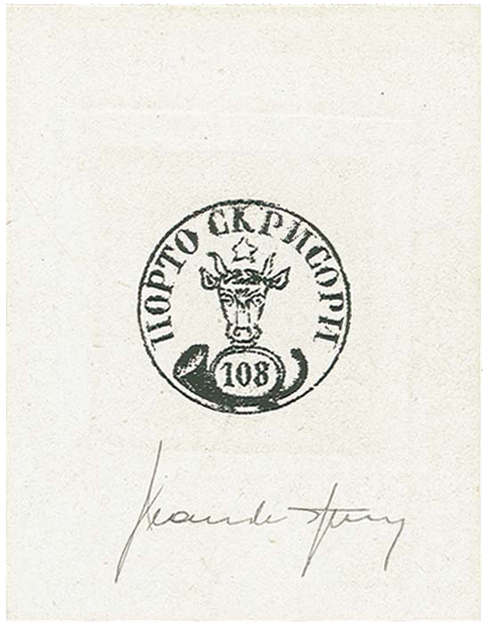
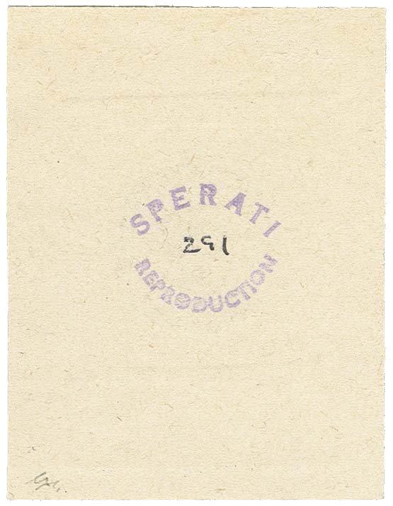
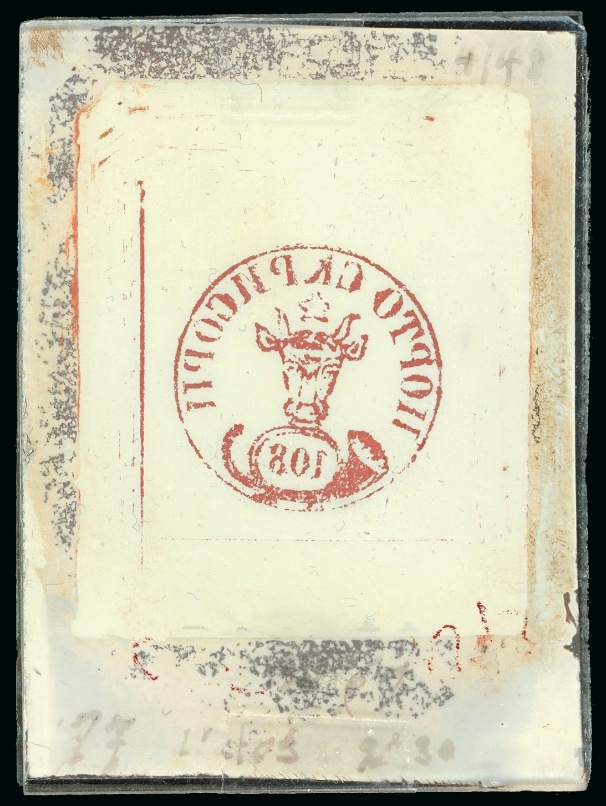
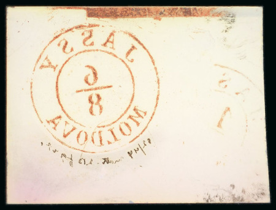

### 108 Parale ⨀ M1 🆁 Replica ⏭ Sperati

<!-- u:u01446 kind:table -->

|  |  |
|---|---|

<!-- u:u01447 kind:text -->
✍ Jean de Sperati

<!-- u:u01448 kind:text -->
⏭ Corinphila 186 📅 2014 💰 280 CHF

<!-- u:u01449 kind:table -->

|  | Glass support cliché \| Suport de sticlă pentru clișeu Support en verre pour cliché \| Glas­träger für Klischee |
|---|---|

<!-- u:u01451 kind:text -->
⏭ David Feldman 📅 2022  ⏭ Lot 50573💰 750 CHF

<!-- u:u01452 kind:text -->
⏭ David Feldman 📅 2023  ⏭ Lot 50573💰 750 CHF (sold)
