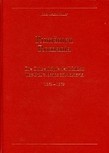

### 📖 Fritz Heimbüchler I 📅 1994

<!-- u:u01660 kind:table -->

| The Bull’s Heads of Moldavia | Capetele de bouri din Moldova |  | Les têtes de taureau de Moldavie | Die Ochsenköpfe der Moldau |
|---|---|---|---|---|
