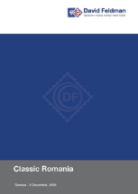

### 📖 David Feldman 📅 2006 - Classic Romania

<!-- u:u01667 kind:table -->

|  | România clasică | Roumanie classique | Klassisches Rumänien |  |
|---|---|---|---|---|
| 2025-09-21 https://www.davidfeldman.com/wp-content/uploads/2014/01/64_1_06_DEC.pdf |  |  |  |  |
| Figure 264, p.290: 108 Parale ✉ ⨀ C1 ⨀ M1 🌍 Piatra Neamţ (Piatra) 📅 13/10 |  |  |  |  |
