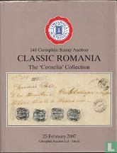

### 📖 Corinphila 149 📅 2007 Classic Romania The „Cornelia Collection” (Part 1)

<!-- u:u01669 kind:table -->

|  | România clasică Colecția „Cornelia” (Partea 1) | Roumanie classique La collection  « Cornelia » (Partie 1) | Klassisches Rumänien Die Sammlung „Cornelia“ (Teil 1) | ? |
|---|---|---|---|---|
| 2025-09-21 ? |  |  |  |  |
| Figure 256, p.282: 81 Parale ✂ ⨀ M1 🌍 Focşani (Fokschani) 16/10 |  |  |  |  |
