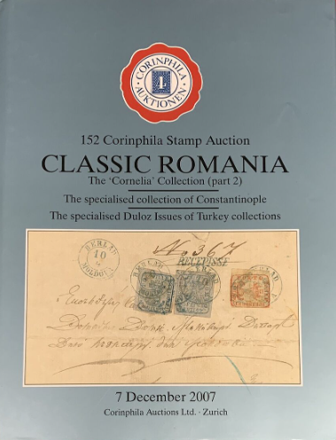

### 📖 Corinphila 152 📅 2007 - Classic Romania The „Cornelia Collection” (Part 2)

<!-- u:u01671 kind:table -->

|  | România clasică Colecția „Cornelia” (Partea 2) | Roumanie classique La collection  « Cornelia » (Partie 2) | Klassisches Rumänien Die Sammlung „Cornelia“ (Teil 2) | ? |
|---|---|---|---|---|
| 2025-09-21 ? |  |  |  |  |
| Figure 262, p.289: 108 Parale ⨀ M1 🌍 Iaşi (Jassy) 📅 5/8 Figure 263, p.289: 108 Parale ⨀ M1 🌍 Iaşi (Jassy) 📅 10/10 |  |  |  |  |
