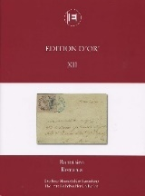

### 📖 Corinphila Edition d'Or XII 📅 2009 - Golden Edition XII: Romania. The Fritz Heimbüchler Collection

<!-- u:u01673 kind:table -->

|  | Ediţia de aur XII: România. Colecția Fritz Heimbüchler | Edition d'Or XII : Roumanie. La collection Fritz-Heimbüchler | Goldene Edition XII XII: Rumänien. Die Fritz-Heimbüchler-Sammlung | ? |
|---|---|---|---|---|
| 2025-09-21 ? |  |  |  |  |
| Figure 253, p.280: 81 Parale ⨀ M1 🌍 Iaşi (Jassy) 📅 10/8 Figure 254, p.281: 81 Parale ✳ |  |  |  |  |
