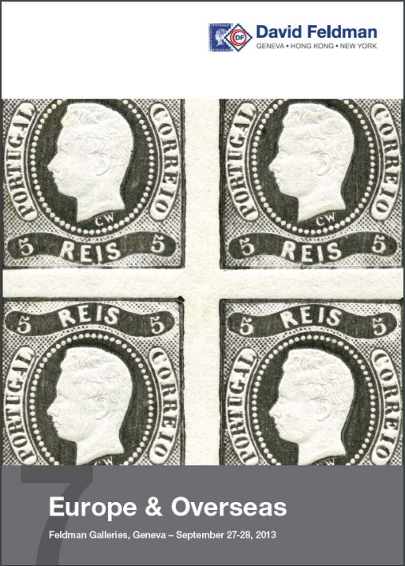

### 📖 David Feldman 📅 2013 - Europe & Overseas

<!-- u:u01683 kind:table -->

|  | Europa și țările de peste mări | Europe & Outre-mer | Europa & Übersee |  |
|---|---|---|---|---|
| 2025-09-21 https://feldmanauctions.com/fia-auctions/2013-september-auction-series/europe-overseas/ |  |  |  |  |
| Figure 191, p.250: 27 Parale ⨀ M1 🌍 Iaşi (Jassy) 📅 18/9 Figure 192, p.250: 27 Parale ⨀ M1 🌍 Focşani (Fokschani) 📅 6/9 |  |  |  |  |
