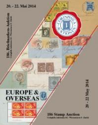
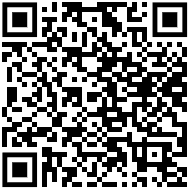

### 📖 Corinphila 186 📅 2014 - Europe A-Z

<!-- u:u01685 kind:table -->

|  | Europa A-Z | Europe A-Z | Europa A-Z |  |
|---|---|---|---|---|
| 2025-09-21 https://d2fk4gnszbwlgj.cloudfront.net/PDF/6/186_Seite_154-193_Lose_1051-1302.pdf |  |  |  |  |
| Figure 198, p.253: 27 Parale ⨀ M1 🌍 Tecuci (Tekutsch) 📅 2/9 Figure 256, p.282: 81 Parale ✂ ⨀ M1 🌍 Focşani (Fokschani) 16/10 |  |  |  |  |
