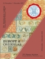

### 📖 Corinphila 291 📅 2022-11 - Europe & Overseas

<!-- u:u01689 kind:table -->

|  | Europa și țările de peste mări | Europe & Outre-mer | Europa & Übersee |  |
|---|---|---|---|---|
| 2025-09-20 https://f660b8feb5396b87e648727b5bf147a985cd65b2-customer-media.s3.amazonaws.com/PDF/24/291_Hauptkat_Inhalt.pdf |  |  |  |  |
| Figure 237, p.271: 54 Parale ✾ 📅 1858 |  |  |  |  |
