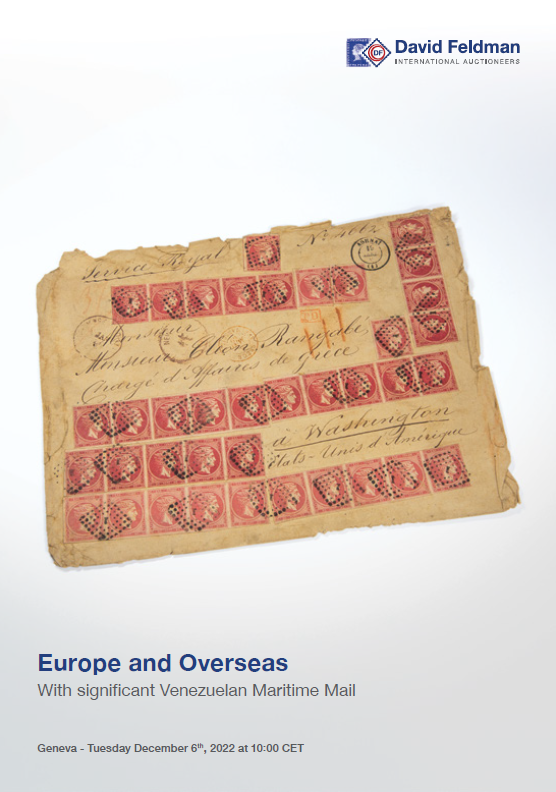

### 📖 David Feldman 📅 2022-12 - Europe & Overseas

<!-- u:u01691 kind:table -->

|  | Europa și țările de peste mări | Europe & Outre-mer | Europa & Übersee |  |
|---|---|---|---|---|
| 2024-12-31 https://www.davidfeldman.com/dfsa-auctions/2022-december/europe-overseas-dec22/ |  |  |  |  |
| Figure 193, p.250: 27 Parale ⨀ M1 🌍 Focşani (Fokschani) 📅 22/9 Figure 194, p.251: 27 Parale ⨀ M1 🌍 Galaţi (Galatz) 📅 24/9 Figure 196, p.252: 27 Parale ⨀ M1 🌍 Iaşi (Jassy) 📅 14/10 Figure 261, p.288: 108 Parale ✳ |  |  |  |  |
