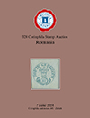

### 📖 Corinphila 328 📅 2024 - Romania

<!-- u:u01697 kind:table -->

|  | România | Roumanie | Rumänien |  |
|---|---|---|---|---|
| 2025-09-20 https://f660b8feb5396b87e648727b5bf147a985cd65b2-customer-media.s3.amazonaws.com/PDF/27/328_Romania.pdf |  |  |  |  |
| Figure 255, p.281: 81 Parale ✾ ⨀ C1 ⨀ M1 🌍 Focşani (Fokschani) |  |  |  |  |
