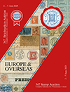

### 📖 Corinphila 347 📅 2025 - Europe & Overseas

<!-- u:u01701 kind:table -->

|  | Europa și țările de peste mări | Europe & Outre-mer | Europa & Übersee |  |
|---|---|---|---|---|
| 2025-09-18 https://f660b8feb5396b87e648727b5bf147a985cd65b2-customer-media.s3.amazonaws.com/PDF/28/347_Maincat_2385-2762.pdf |  |  |  |  |
| Figure 236, p.270: 54 Parale ⨀ M1 🌍 Iaşi (Jassy) 📅 23/9 |  |  |  |  |
