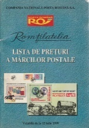
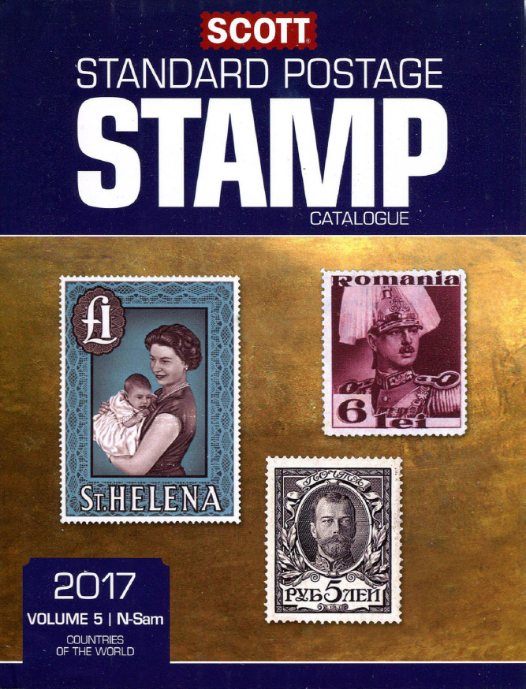
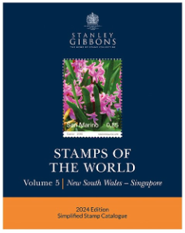
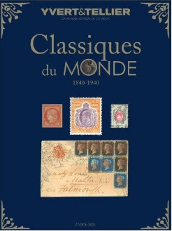
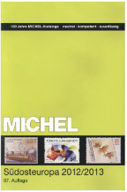
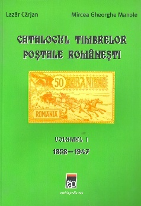
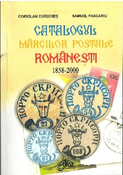
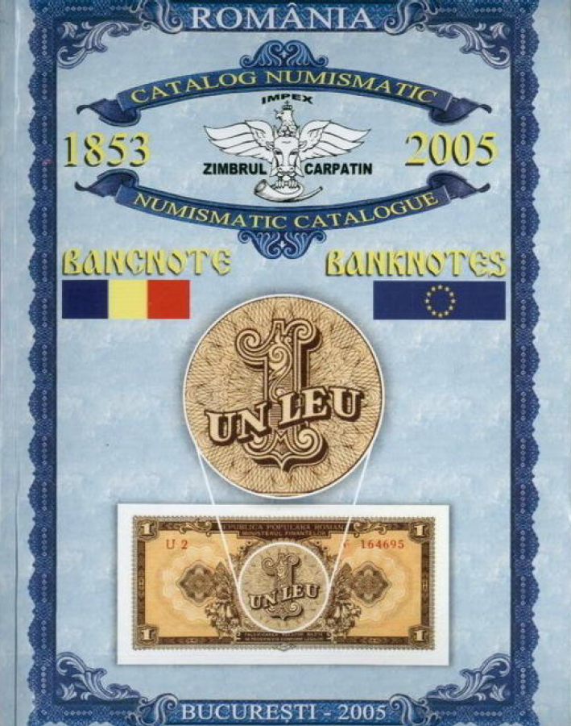
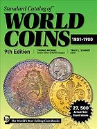

## Catalogues

<!-- u:u01704 kind:table -->

| Lista de Preţuri | Scott | Stanley Gibbons | Yvert et Tellier | Michel |
|---|---|---|---|---|
| 📖 LP | 📖 SC | 📖 SG | 📖 YT | 📖 MI |
| Catalogue of Romanian postage stamps, volume I (1858-1947) | Catalogul timbrelor poştale româneşti, volumul I (1858-1947) | 📖 Catalog 2006 | Catalogue des timbres-poste roumains, volume I (1858-1947) | Katalog rumänischer Briefmarken, Band I (1858-1947) |
| Catalogue of Romanian postage stamps, volume I (1858-2000) | Catalogul mărcilor poştale româneşti, volumul I (1858-2000) | 📖 Catalog 2024 | Catalogue des timbres-poste roumains, volume I (1858-2000) | Katalog rumänischer Briefmarken, Band I (1858-2000) |
| The Carpathian Bison - Numismatic Catalogue - Banknotes 1853-2005 | Zimbrul Carpatin - Catalog numismatic - Bancnote 1853-2005 | 📖 ZC | Le Bison des Carpates - Catalogue numismatique - Billets de banque 1853-2005 | Der Karpatenwisent - Numismatischer Katalog - Banknoten 1853-2005 |
| Standard Catalog of World Coins | Catalog standard al monedelor mondiale | 📖 KM | Catalogue standard des monnaies du monde | Standardkatalog der Weltmünzen |
