## Figures ⏭ 🐃 The Aurochs (§2)

<!-- u:u02021 kind:table -->
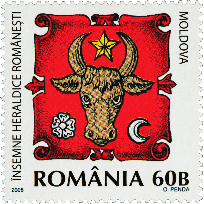

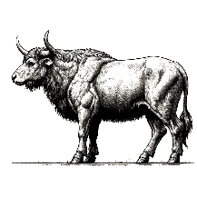

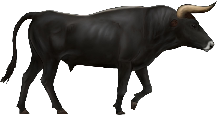

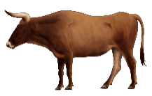

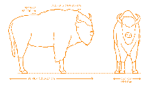

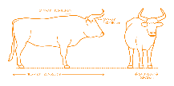

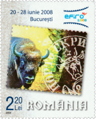

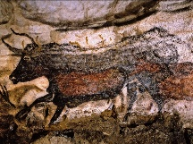

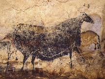

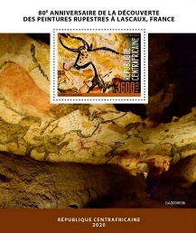

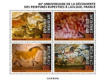

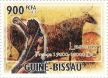

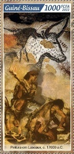

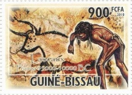

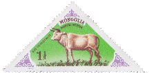

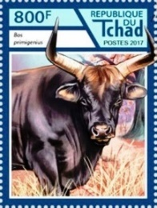

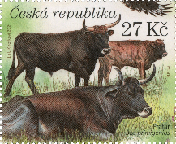

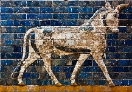

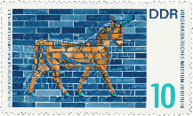

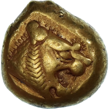

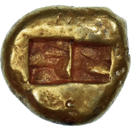

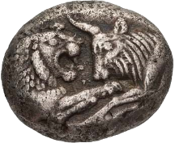

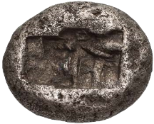

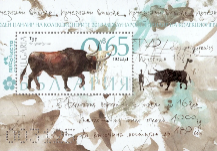

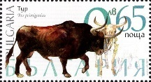

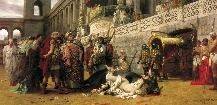

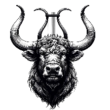

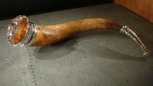

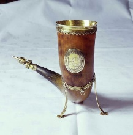

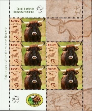

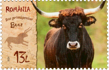

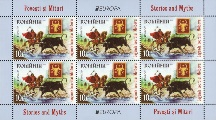

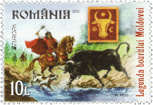

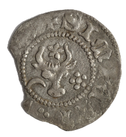

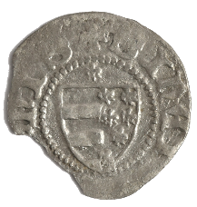

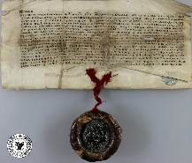

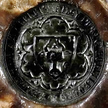

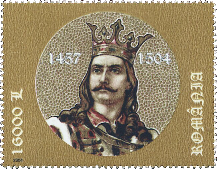

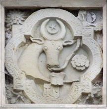

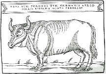

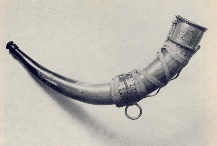

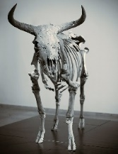

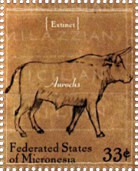

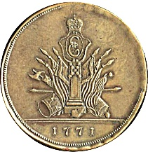

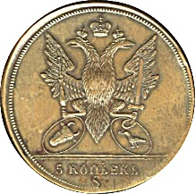

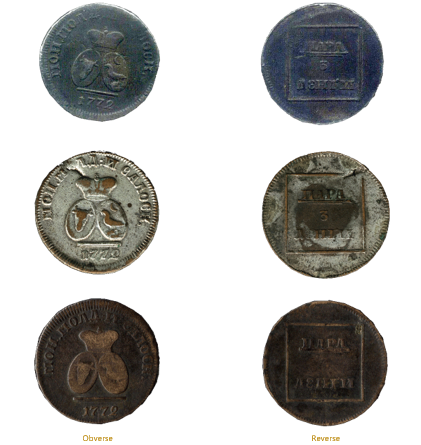

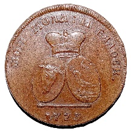

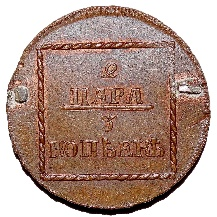

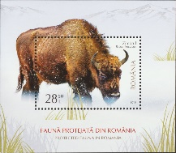

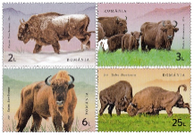

| Table 21: Figures ⏭ 🐃 The Aurochs (§2) |  |  |  |
|---|---|---|---|
| Figure 1, p.17 | 🐃 ⭐ 🌸🌙 📖 MI RO 6326 | ⏭ 2024-12-08: https://colnect.com/en/stamps/stamp/205595-Moldova-Romanian_Heraldic_Symbols-Romania |  |
| Figure 2, p.19 | 🐃 🧭 Maximum Historic Range | ⏭ 📖 Aurochs, 2014 |  |
| Figure 3, p.20 | 🐃 Habitat | ⏭ DALL-E |  |
| Figure 4, p.21 | 🐃 ♂ | ⏭ DALL-E |  |
| Figure 5, p.22 | 🐃 ♀ | ⏭ DALL-E |  |
| Figure 6, p.23 | 🐃 ♂ ♀ 🎨 | ⏭ 2024-06-12: https://en.wikipedia.org/wiki/Aurochs#/media/File:Aurochsfeatures.jpg |  |
| Figure 7, p.25 | 🐃 Aurochs & 🦬 Bison  (Aurochs) | ⏭ 2024-10-06: https://www.dimensions.com/element/european-bison-bison-bonasus |  |
| Figure 7, p.25 | Bison | ⏭ 2024-10-06: https://www.dimensions.com/element/auroch-bos-primigenius |  |
| Figure 8, p.26 | 🐃 🦬 📖 MI RO 6122 | ⏭ 2024-08-04: https://colnect.com/en/stamps/stamp/1489462-European_Bison_Bison_bonasus-World_Philatelic_Exhibition_EFIRO_2008_I-Romania |  |
| Figure 9, p.27 | 🐃 🌍 Lascaux, France | ⏭ 2024-04-26: https://archeologie.culture.gouv.fr/lascaux/en/mediatheque |  |
| Figure 10, p.28 | 🐃 🌍 Lascaux | ⏭ Figure 9 |  |
| Figure 11, p.29 | 🐃 📖 YT CF BF1664 | ⏭2024-09-20: https://colnect.com/en/stamps/stamp/1023551-80th_Anniversary_of_the_Discovery_of_Cave_Paintings-Discovery_of_Lascaux_Cave_Paintings_80th_Anniversary_2020-Central_African_Republic |  |
| Figure 12, p.29 | 🐃 📖 YT CF 7134-7137 | ⏭ 2024-09-20: https://colnect.com/en/stamps/stamp/1023550-80th_Anniversary_of_the_Discovery_of_Cave_Paintings-Discovery_of_Lascaux_Cave_Paintings_80th_Anniversary_2020-Central_African_Republic |  |
| Figure 13, p.29 | 🐃 📖 YT GW 3598 | ⏭ 2024-09-20: https://colnect.com/en/stamps/stamp/1376704-Cave_Of_Lascaux-Cave_Of_Lascaux_2010-Guinea-Bissau |  |
| Figure 14, p.29 | 🐃 📖 YT GW 10407 | ⏭ 2024-09-20: https://colnect.com/en/stamps/stamp/1509453-Painting_at_Lascaux_c_17000_BC-Cave_Paintings_2022-Guinea-Bissau |  |
| Figure 15, p.29 | 🐃 📖 YT GW 3598 | ⏭ 2024-09-20: https://colnect.com/en/stamps/stamp/1376703-Cave_Of_Lascaux-Cave_Of_Lascaux_2010-Guinea-Bissau |  |
| Figure 16, p.30 | 🐃 📖 MI MN 1071 | ⏭ 2024-09-20: https://colnect.com/en/stamps/stamp/247968-Aurochs_Bos_primigenius-Prehistorical_Animals_1977-Mongolia |  |
| Figure 17, p.30 | 🐃 📖 MI TD 3108 | ⏭ 2024-09-20: https://colnect.com/en/stamps/stamp/1032135-Aurochs_Bos_primigenius-Extinct_Species_2017-Chad |  |
| Figure 18, p.30 | 🐃 📖 MI CZ 1126 | ⏭ 2024-07-01: https://colnect.com/en/stamps/stamp/1130366-Aurochs_Bos_primigenius-Milovice_Nature_Reserve_2021-Czech_Republic |  |
| Figure 19, p.31 | 🐃 Adad 🌍 Ishtar Gate | ⏭ 2024-05-19: https://www.worldhistory.org/image/738/aurochs-from-ishtar-gate/ |  |
| Figure 20, p.31 | 🐃 📖 MI DD 1229 | ⏭ 2024-09-12: https://colnect.com/en/stamps/stamp/113204-Bull_of_the_Ishtar_Gate-Artwork_from_Near_Eastern_Museum_Berlin-Germany_Democratic_Republic_DDR |  |
| Figure 21, p.32 | Electrum coin 💰 Lydian Lion  Obverse | ⏭ 2024-05-19: https://www.ebay.com/itm/145698996893 |  |
| Figure 21, p.32 | Reverse  $ 10`516 📅 2024 |  |  |
| Figure 22, p.33 | Silver Croeseid 💰 Aurochs and Lion  Obverse | ⏭ 2024-05-19: https://www.wildwinds.com/coins/greece/lydia/t.html |  |
| Figure 22, p.33 | Reverse  $ 1500 📅 2018 | ⏭ 📖 Sear SG 3421 |  |
| Figure 23, p.36 | 🐃 📖 MI BG 5383, 5387C  (5383) | ⏭ 2024-07-01: https://www.buyhungarianstamps.com/products/bulgaria-2018-fauna-extinct-species-limited-edition-s-s-mnh |  |
| Figure 23, p.36 | 5387C | ⏭ 2024-09-28: https://colnect.com/en/stamps/stamp/860257-Aurochs_Bos_primigenius-Extinct_Species_2018-Bulgaria |  |
| Figure 24, p.38 | 🐃 The Christian Dirce ✍ Henryk Siemiradzki | ⏭ 2024-07-02: https://en.wikipedia.org/wiki/Damnatio_ad_bestias#/media/File:Siemiradzki_Christian_Dirce.jpg |  |
| Figure 25, p.39 | 🐃 Lyre-shaped horns | ⏭ DALL-E |  |
| Figure 26, p.40 | 🐃 Silver-plated drinking horn | ⏭ 2024-07-02:  https://en.wikipedia.org/wiki/Drinking_horn#/media/File:Drinkhoorn_roordahuizum.JPG |  |
| Figure 27, p.41 | 🐃 Drinking horn with legs for flat surfaces | ⏭ 2024-04-28: https://journals.ub.uni-heidelberg.de/index.php/akb/article/download/39767/33430 |  |
| Figure 27, p.41 | 🐃 Drinking horn with legs for flat surfaces | ⏭ 2024-04-28: https://www.varsity.co.uk/features/8991 |  |
| Figure 28, p.43 | 🐃 📖 MI RO 8311AKB | ⏭ 2024-08-04: https://colnect.com/en/stamps/stamp/1461316-Aurochs_Bos_primigenius-Extinct_Species_from_the_Fauna_of_Romania-Romania |  |
| Figure 28, p.43 | 🐃 📖 MI RO 8311AKB | ⏭ 2024-08-04: https://colnect.com/en/stamps/stamp/1461312-Aurochs_Bos_primigenius-Extinct_Species_from_the_Fauna_of_Romania-Romania |  |
| Figure 30, p.44 | 🐃 Comes Tristanus 📅 1255 | ⏭ 📖 Tiron, 2020  p.86, Planşa III |  |
| Figure 31, p.45 | 🐃 Transylvanian and Hungarian seals 📅 XIV | ⏭ 📖 Tiron, 2020  p.86, Planşa III |  |
| Figure 32, p.47 | 🐃 📖 MI RO 8001AKB, 8001A  (8001AKB) | ⏭2024-07-02: https://colnect.com/en/stamps/stamp/1214626-Legend_of_the_Moldavian_Aurochs-Europa_CEPT_2022_-_Stories_and_Myths-Romania |  |
| Figure 32, p.47 | 8001A | ⏭2024-07-02: https://colnect.com/en/stamps/stamp/1214625-Legend_of_the_Moldavian_Aurochs-Europa_CEPT_2022_-_Stories_and_Myths-Romania |  |
| Figure 33, p.50 | 💰 Silver Groshen 🐃 🌙 🌸 Petru Muşat  Obverse | ⏭ 2024-04-29:   https://www.artmark.ro/ro/licitatie/istoria-monedei-romanesti-licitatia-unei-colectii-de-numismatica-partea-ii-4812022/lot/moneda-gros-petru-ii-musat-1375-1391-argint-prima-moneda-batuta-de-un-domnitor-al-moldovei-ro-72435 |  |
| Figure 33, p.50 | Reverse  € 600 📅 2022 | ⏭ 📖 Numista #122385, #122386 |  |
| Figure 34, p.51 | Seal of Roman I 📅 1392-03-30 | ⏭ 2024-04-28: https://salutaridinroman.wordpress.com/wp-content/uploads/2018/08/1392-prima-mentiune-documentara-a-cetatii-musatine-de-la-roman-in-timpul-domniei-lui-roman-i-musat-cel-mai-vechi-document-din-moldova.jpg |  |
| Figure 35, p.52 | 🔍 Seal of Roman I 🐃 🌸 🌙 | ⏭ Figure 34 🔍 |  |
| Figure 36, p.54 | 🐃 🌸 🌙 Stephen's seal | ⏭ 2024-08-04:  https://ro.m.wikipedia.org/wiki/Fi%C8%99ier:Seal_of_Stephen_III_of_Moldavia.svg |  |
| Figure 37, p.54 | 📖 MI RO 5842 | ⏭ 2024-09-18: https://colnect.com/en/stamps/stamp/204560-Voivode_Stephen_the_Great-500th_Death_Anniversary_of_Stephen_the_Great-Romania |  |
| Figure 38, p.55 | Coat of arms 🌍 Putna Monastery | ⏭ 2024-04-28:  https://en.wikipedia.org/wiki/Stephen_the_Great#/media/File:Seal_of_Stephen_III_of_Moldavia.svg |  |
| Figure 39, p.56 | 🐃 Illustration 📅 XVIth century | ⏭ 2024-08-04: https://ro.wikipedia.org/wiki/Fi%C8%99ier:Tur_ZHerberstein_pol_XVIw_small.jpg |  |
| Figure 40, p.57 | 🐃 Hunting horn of Sigismund III of Poland | ⏭ 2024-04-28: https://en.m.wikipedia.org/wiki/File:Hunting_horn_of_Sigismund_III_of_Poland.jpg |  |
| Figure 41, p.58 | 🐃 Skeleton | ⏭ 2024-04-26: https://en.wikipedia.org/wiki/Aurochs#/media/File:Copenhagen_Aurochse.jpg |  |
| Figure 42, p.58 | 🐃 📖 MI FM 786 | ⏭ 2024-09-20:  https://colnect.com/en/stamps/stamp/360590-Aurochs_Bos_primigenius-Earth_Day-Micronesia_Federated_States_of |  |
| Figure 43, p.62 | 3 Para + 1 Denghi = 5 Kopecks 💰 Sadagura 📅 1771  Obverse | ⏭ 2025-01-07: https://en.numista.com/catalogue/pieces70851.html |  |
| Figure 43, p.62 | Reverse  Composition: Bronze Weight: 37.9 g ∅: 42.5 mm |  |  |
| Figure 44, p.63 | 1 Para = 3 Denghi 💰 Sadagura 📅 1772 | ⏭ 2025-01-07: https://monederomanesti.cimec.ro/sadagura.htm |  |
| Figure 45, p.64 | 2 Para = 3 Kopecks 💰 Sadagura 📅 1773  Obverse | ⏭ 2025-01-07: https://en.numista.com/catalogue/pieces7617.html |  |
| Figure 45, p.64 | Reverse  Composition: Bronze Weight: 22.2 g ∅: 34 mm |  |  |
| Figure 46, p.65 | 🦬 📖 MI RO BL789 | ⏭ 2024-08-29: https://colnect.com/ro/stamps/stamp/859157-European_Bison_Bison_bonasus-Protected_Fauna_2019-Rom%C3%A2nia |  |
| Figure 47, p.65 | 🦬 📖 LP 2448 | ⏭ 2024-10-01: https://filatelia.ro/timbre-romania-2024/ziua-mondiala-a-rezervatiilor-naturale-2024-lp-2448.html |  |
| Figure 48, p.67 | 🐃 Lamborghini Urus | ⏭ 2024-09-25: https://www.lamborghini.com/en-en/models/urus |  |
