## Figures ⏭ XIXth Century 📅 (§3)

<!-- u:u02023 kind:table -->
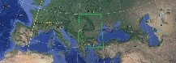

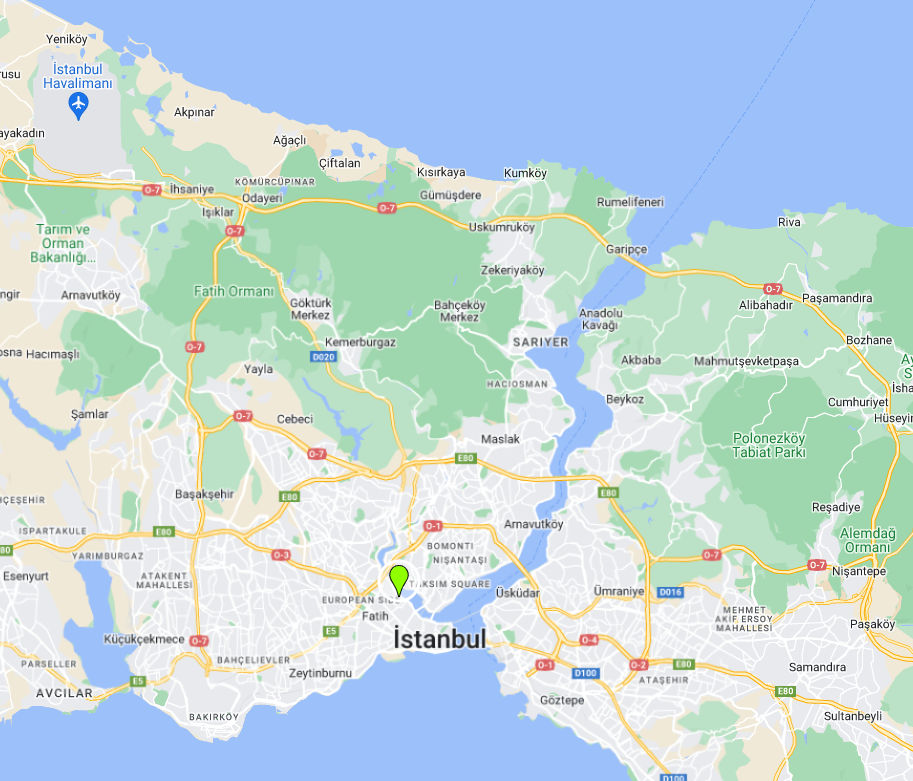

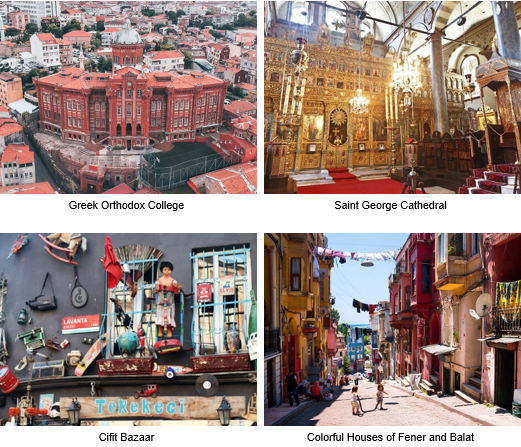

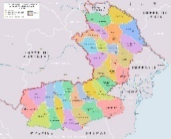

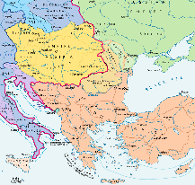

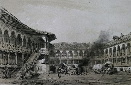

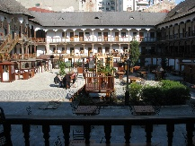

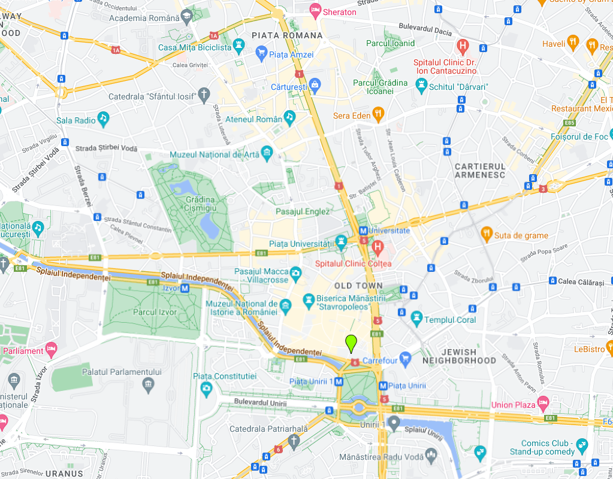

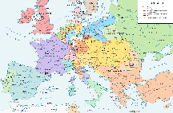

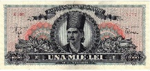

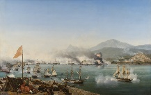

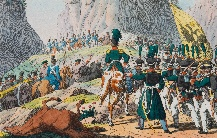

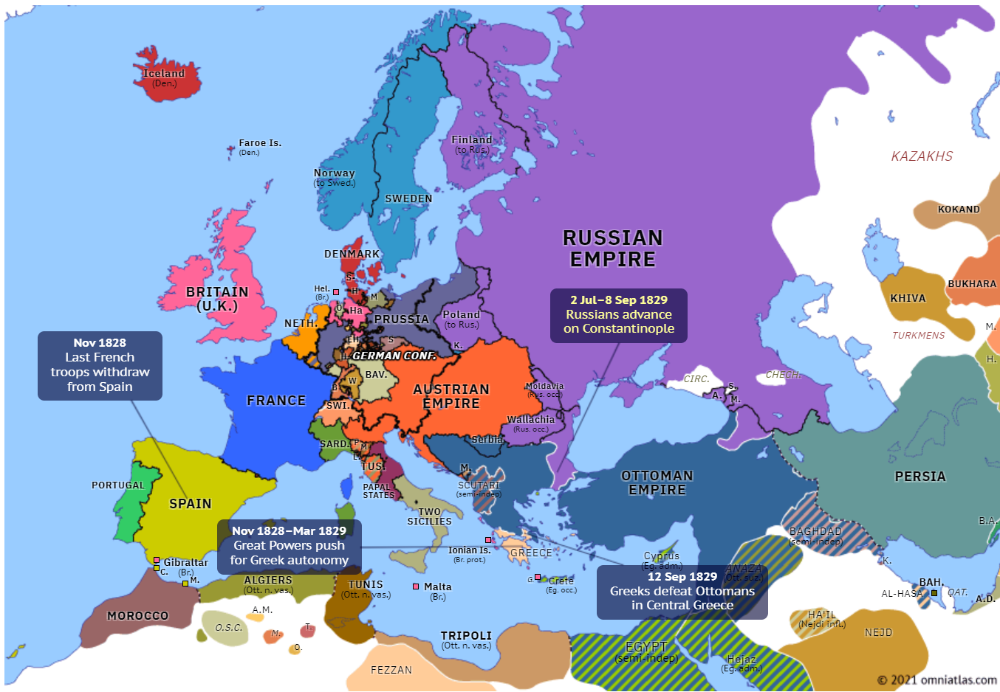

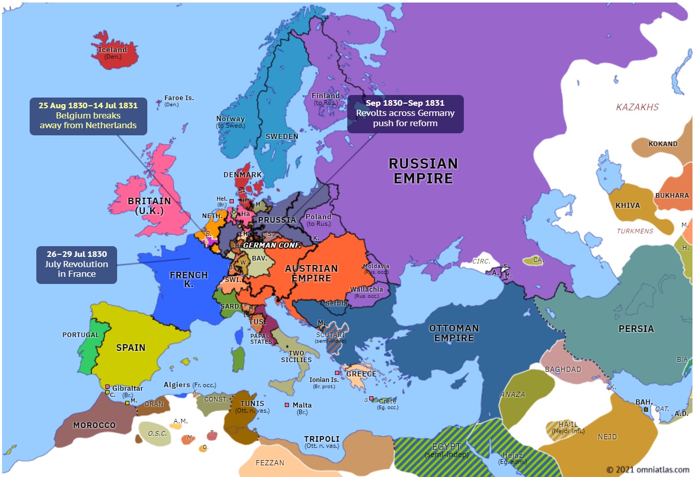

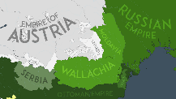

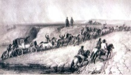

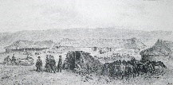

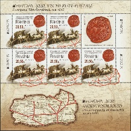

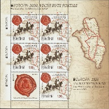

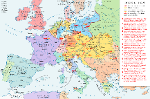

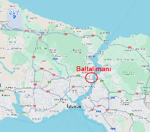

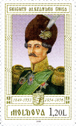

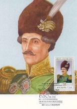

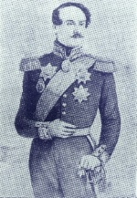

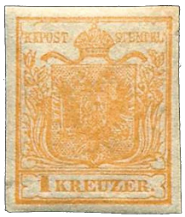

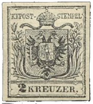

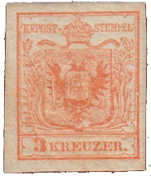

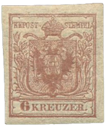

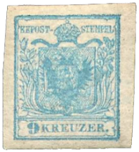

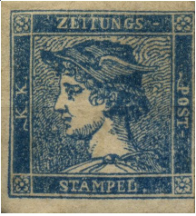

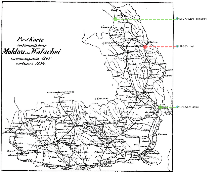

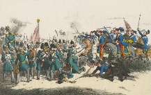

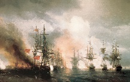

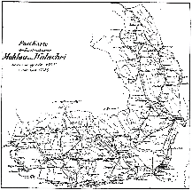

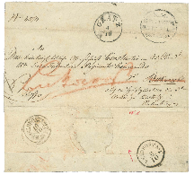

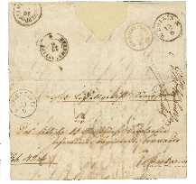

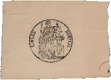

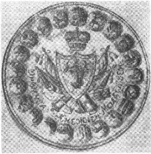

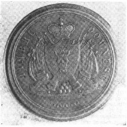

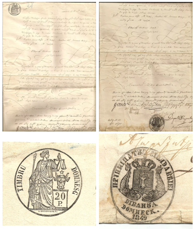

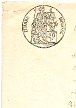

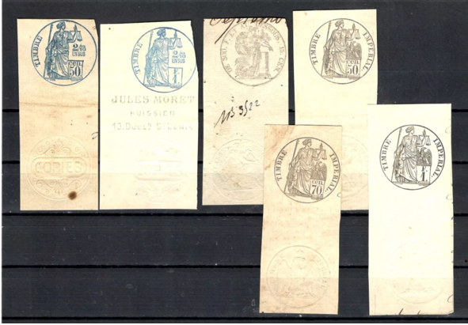

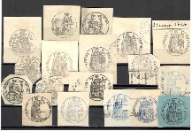

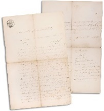

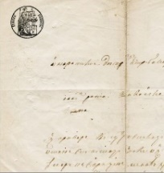

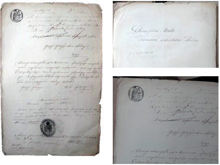

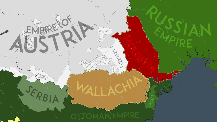

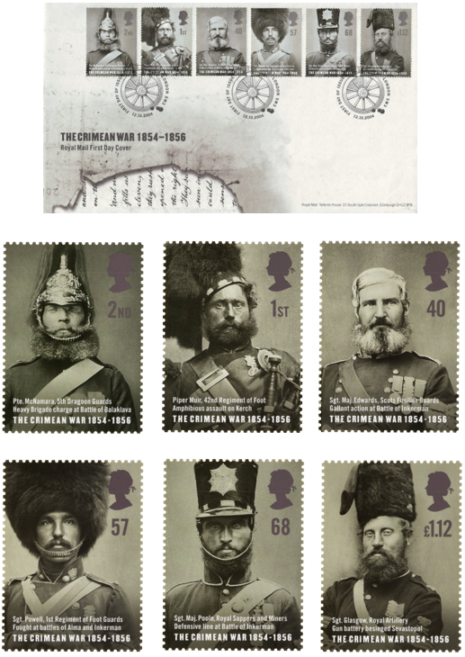

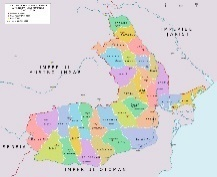

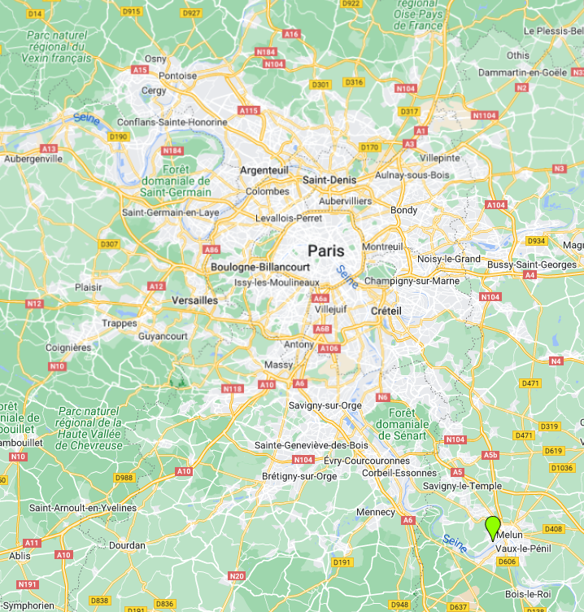

| Table 22: Figures ⏭ XIXth Century 📅 (§3) |  |  |  |
|---|---|---|---|
| Figure 49, p.68 | 🧭 Balkan Peninsula 🌍 | ⏭ 2024-08-25: https://earth.google.com/ |  |
| Figure 50, p.71 | 🧭 Fener 🌍 Istanbul 📅 Today | ⏭ 2024-09-11: https://www.google.com/maps |  |
| Figure 51, p.72 | Fener 🌍 Istanbul 📅 Today | ⏭ 2024-09-11: https://madeinturkeytours.com/guide-visiting-fener-balat-istanbul/ |  |
| Figure 52, p.74 | 🧭 Counties 🌍 Moldavia, Wallachia 📅 1800 | ⏭ 2024-05-09: https://ro.wikipedia.org/wiki/Jude%C8%9B |  |
| Figure 53, p.76 | 🧭 Conflicts 🌍 Europe 📅 1809 | ⏭ 2024-09-18: https://omniatlas.com/maps/europe/18091014/ |  |
| Figure 54, p.77 | 🧭 Conflicts 🌍 Europe 📅 1810 – 1811 | ⏭ 2024-09-18: https://omniatlas.com/maps/europe/18290913/ |  |
| Figure 55, p.77 | 🧭 Battle of Slobozia 🌍 Europe 📅 1811 | ⏭ 2024-09-18: https://omniatlas.com/maps/europe/18111014/ |  |
| Figure 56, p.78 | 🧭 Treaty of Bucharest 🌍 Bessarabia  Russia 📅 1812 | ⏭ 2024-08-07: https://en.wikipedia.org/wiki/Russo-Turkish_War_(1806%E2%80%931812) |  |
| Figure 57, p.79 | Litograph 🌍 Manuc’s Inn 📅 1841 | ⏭ 2024-08-07: https://ro.wikipedia.org/wiki/Hanul_Manuc#/media/Fi%C8%99ier:Hanul_lui_Manuc,_1841.jpg |  |
| Figure 58, p.79 | Photograph 🌍 Manuc’s Inn 📅 2012 | ⏭ 2024-08-07: https://unknownbucharest.com/wp-content/uploads/2011/07/2012-04-10-hanul-lui-manuc-010.jpg?w=2000&h= |  |
| Figure 59, p.80 | Restaurant Hanu’ Lui Manuc 📅 Today | ⏭ 2024-09-08: https://www.tripadvisor.com/Hotel_Review-g294458-d601681-Reviews-Hanul_lui_Manuc-Bucharest.html?m=19905 |  |
| Figure 60, p.81 | 🧭 Hanu’ Lui Manuc 🌍 Bucharest 📅 Today | ⏭ 2024-09-08: https://www.google.com/maps |  |
| Figure 61, p.82 | 🧭 Congress 🌍 Vienna 📅 1815 | ⏭ 2024-12-11: https://en.wikipedia.org/wiki/Congress_of_Vienna |  |
| Figure 62, p.83 | 💰 1000 Lei 🌍 People's Republic of Romania 📅 1948 | ⏭ 2024-08-27: https://ro.wikipedia.org/wiki/Tudor_Vladimirescu |  |
| Figure 63, p.84 | Naval battle 🌍 Navarino 📅 1827 | ⏭ 2024-09-16: https://en.wikipedia.org/wiki/Battle_of_Navarino |  |
| Figure 64, p.84 | Russian army 🌍 Balkans 📅 1829 | ⏭ 2024-09-16: https://en.wikipedia.org/wiki/Russo-Turkish_War_(1828%E2%80%931829) |  |
| Figure 65, p.85 | 🧭 Russo-Turkish War 🌍 Europe 📅 1828 – 1829 | ⏭ 2024-09-18: https://omniatlas.com/maps/europe/18290913/ |  |
| Figure 66, p.85 | 🧭 End of Russo-Turkish War 🌍 Europe 📅 1829 – 1830 | ⏭ 2024-09-18: https://omniatlas.com/maps/europe/18300614/ |  |
| Figure 67, p.86 | 🧭 Treaty of Adrianople 🌍 Moldavia, Wallachia 📅 1829 | ⏭ 2024-09-18: https://en.wikipedia.org/wiki/Treaty_of_Adrianople_(1829) |  |
| Figure 68, p.90 | Crossing the Buzău river✍ Auguste Raffet 🌍 Wallachia 📅 1837 | ⏭ 2024-10-01: https://clasate.cimec.ro/Detaliu.asp?tit=litografie--Raffet-Auguste-Denis-Marie--Trecerea-prin-vad-a-Buzaului&k=7DC02D942B9D49489DC51958C114CA1C |  |
| Figure 69, p.91 | Menzil 📯 Poste aux Chevaux ✍ Auguste Raffet 🌍 Moldavia 📅 1837 | ⏭ 2024-10-01: https://www.anticariat-unu.ro/auguste-raffet-1804-1860-statia-de-posta-moldova-1837-p163497 |  |
| Figure 70, p.91 | Menzil 📯 Poste aux Chevaux ✍ Auguste Raffet 🌍 Bessarabie 📅 1837 | ⏭ 2024-10-01: https://commons.wikimedia.org/wiki/File:Raffet_-_Bessarabie,_5_Ao%C3%BBt_1837_-_Poste_aux_chevaux.jpg |  |
| Figure 71, p.92 | 📖 MI RO 7693AKB | ⏭ 2024-10-01: https://colnect.com/en/stamps/stamp/1023207-Postal_Routes_of_1840_in_Wallachia-Europa_CEPT_2020_-_Ancient_Postal_Routes-Romania |  |
| Figure 72, p.93 | 📖 MI RO 7692AKB | ⏭ 2024-10-01: https://colnect.com/en/stamps/stamp/1023206-Postal_Routes_of_1840_in_Moldavia_MS-Europa_CEPT_2020_-_Ancient_Postal_Routes-Romania |  |
| Figure 73, p.94 | ✉ Penny Black 📖 SG 2  £ 1000 📅 2024 | ⏭ 2024-08-07: https://www.stanleygibbons.com/products/gb-1840-sg2-pl8-penny-black-london-deal-unusual-pin-cancel |  |
| Figure 74, p.97 | 🧭 Europe 🌍 Moldavian Revolution 📅 1848-03-28 | ⏭ 2024-09-19: https://omniatlas.com/maps/europe/18480321/ |  |
| Figure 75, p.97 | 🧭 Europe 🌍 Wallachian Revolution 📅 1848-06-21 | ⏭ 2024-09-28: https://omniatlas.com/maps/europe/18480623/ |  |
| Figure 76, p.98 | 🧭 Revolutions 🌍 Europe 📅 1848 | ⏭ 2024-09-28: https://en.wikipedia.org/wiki/Revolutions_of_1848 |  |
| Figure 77, p.101 | 🧭 Baltalimanı 🌍 Istanbul 📅 Today | ⏭ 2024-08-04: https://maps.app.goo.gl/6Wv186UMxKDWD1MDA |  |
| Figure 78, p.102 | 📖 MI MD 629 | ⏭ 2024-08-04: https://colnect.com/en/stamps/stamp/216629-Grigore_Alexandru_Ghica_1849-1853_1854-1856-Princes_of_Moldavia_18th-19th_cent-Moldova |  |
| Figure 79, p.102 | FDC ✉ 📖 MI MD 629102 | ⏭ 2024-09-17: https://en.wikipedia.org/wiki/Grigore_Alexandru_Ghica |  |
| Figure 80, p.102 | Grigore Alexandru Ghica V | ⏭ 2024-08-04: https://ro.wikipedia.org/wiki/Grigore_Alexandru_Ghica |  |
| Figure 81, p.103 | 📖 MI AT 1XbI | ⏭ 2024-09-28: https://colnect.com/en/stamps/stamp/680240-Coat_of_arms-Coat_of_arms_185054-Austria |  |
| Figure 82, p.103 | 📖 MI AT 2XaI | ⏭ 2024-09-28: https://colnect.com/en/stamps/stamp/16414-Coat_of_arms-Coat_of_arms_185054-Austria |  |
| Figure 83, p.103 | 📖 MI AT 3XaI | ⏭ 2024-09-28: https://colnect.com/en/stamps/stamp/16415-Coat_of_arms-Coat_of_arms_185054-Austria |  |
| Figure 84, p.103 | 📖 MI AT 4XaI | ⏭ 2024-09-28: https://colnect.com/en/stamps/stamp/16416-Coat_of_arms-Coat_of_arms_185054-Austria |  |
| Figure 85, p.103 | 📖 MI AT 5XaI | ⏭ 2024-09-28: https://colnect.com/en/stamps/stamp/16417-Coat_of_arms-Coat_of_arms_185054-Austria |  |
| Figure 86, p.104 | 📖 MI AT 6II | ⏭ 2024-09-28: https://colnect.com/en/stamps/stamp/684945-Mercurius-Newspaper_stamps_185156-Austria |  |
| Figure 87, p.104 | 📖 MI AT 7Ia | ⏭ 2024-09-28: https://colnect.com/en/stamps/stamp/16420-Mercurius-Newspaper_stamps_185156-Austria |  |
| Figure 88, p.104 | 📖 MI AT 8Ia | ⏭ 2024-09-28: https://colnect.com/en/stamps/stamp/16421-Mercurius-Newspaper_stamps_185156-Austria |  |
| Figure 89, p.105 | 🧭 New postal route 🌍 Moldavia 📅 1852 | ⏭ Figure 94 |  |
| Figure 92, p.112 | Battle 🌍 Olteniţa 📅 1853-11-04 | ⏭ 2024-09-16: https://en.wikipedia.org/wiki/Battle_of_Olteni%C8%9Ba |  |
| Figure 93, p.112 | Naval battle 🌍 Sinop 📅 1853-11-30 | ⏭ 2024-09-16: https://en.wikipedia.org/wiki/Battle_of_Sinop |  |
| Figure 94, p.114 | 🧭 📯 Postal Routes 🌍 Moldavia & Wallachia 📅 1854 | ⏭ 📖 Minescu, 1916 (p.185) |  |
| Figure 95, p.120 | ✉ 1854 Cover 🌍  Bucharest | ⏭ 2024-12-31: https://corinphila.ch/en/_auctions/&action=showLot&auctionID=6&lotno=1109 |  |
| Figure 96, p.121 | ✉ ✂ 1855 Cover 🌍  Bucharest | ⏭ Figure 95 |  |
| Figure 97, p.124 | Timbru Domnesc – Wet  € 100 📅 2019 | ⏭ 2024-08-04: https://www.okazii.ro/romania-1858-1860-timbru-domnesc-cap-de-bour-a203785103 |  |
| Figure 98, p.125 | Seal of the High Council of Moldavia 📅 Late XVIII – Early XIX | ⏭ 📖 Ciofu, 1974 |  |
| Figure 99, p.125 | Bronze seal of the „dry” Princely Stamp | ⏭ 📖 Ciofu, 1974 |  |
| Figure 100, p.126 | 1857 📅 Timbru Domnesc ⨀ „Principatul Moldaviei / Divanul Domnesc 1849”  € 1`680 📅 2024 | ⏭ 2024-08-30: https://www.ebay.com/itm/273663510047 |  |
| Figure 101, p.127 | 1857 📅 Timbru Domnesc – „Wet” and „Dry” stamps | ⏭ Figure 100 |  |
| Figure 102, p.128 | XIXth Century 📅 Fiscal tax stamps 🌍 France  $ 5.50 📅 2024 | ⏭ 2024-08-30: https://www.ebay.com/itm/116304882306 |  |
| Figure 102, p.128 | $ 20.50 📅 2024 | ⏭ 2024-08-30: https://www.ebay.com/itm/116306700887 |  |
| Figure 103, p.129 | Timbru Domnesc – Complaint regarding stolen horses | ⏭ 2024-08-04: https://historic.ro/jalba-1856-cu-timbru-domnesc-de-20-parale.html |  |
| Figure 103, p.129 | € 200 📅 2024 |  |  |
| Figure 104, p.130 | 1862 📅 Timbru Domnesc 🌍 United Principalities ⨀ | ⏭ 2024-12-31: https://www.okazii.ro/primul-timbru-fiscal-romanesc-timbru-domnesc-1861-a44412542 |  |
| Figure 105, p.131 | 🧭 Treaty of Paris 🌍 Moldavia, Wallachia 📅 1856 | ⏭ 2024-09-23: https://en.wikipedia.org/wiki/Treaty_of_Paris_(1856) |  |
| Figure 106, p.132 | ✉ FDC 📖 SG 2489 – 2494 | ⏭ 2024-09-23: https://www.collectgbstamps.co.uk/explore/issues/?issue=376 |  |
| Figure 107, p.133 | Encampment of the Horse Artillery during the Crimean War 📅 1855  Photograph by Roger Fenton | ⏭ 2024-09-23: https://www.britannica.com/event/Crimean-War |  |
| Figure 108, p.133 | Four Zouaves with their bayonetted rifles during the Crimean War 📅 1855  Photograph by Roger Fenton | ⏭ Figure 107 |  |
| Figure 109, p.134 | 🧭 Treaty of Paris 🌍 Europe 📅 1856 | ⏭ 2024-09-23: https://omniatlas.com/maps/europe/18560330/ |  |
| Figure 110, p.134 | 🧭 Europe 📅 1857 | ⏭ 2024-09-23: https://omniatlas.com/maps/europe/18570401/ |  |
| Figure 111, p.135 | 🧭 Counties 🌍 Moldavia, Wallachia 📅 1856 – 1878 | ⏭ 2024-05-09: https://ro.wikipedia.org/wiki/Jude%C8%9B |  |
| Figure 112, p.142 | Résidence Château du Mée 📅 Today | ⏭ 2024-09-08: https://www.rcdm.fr/ |  |
| Figure 113, p.143 | 🧭 Résidence Château du Mée 🌍 Le Mée-sur-Seine 📅 Today | ⏭ 2024-09-08: https://www.google.com/maps |  |
| Figure 114, p.149 | 5 x 10 Kopecks ⨀ 📖 MI RU 1a | ⏭ 2024-09-07: https://rusphil.com/russian-empire-1857-1917/russian-empire-first-issue-1857-1858 |  |
| Figure 115, p.149 | 📖 MI RU 1PFI | ⏭ 2024-09-07: https://colnect.com/en/stamps/stamp/875237-Coat_of_Arms_of_Russian_Empire_Postal_Dep_with_Mantle-1st_Definitive_Issue_of_Russian_Empire-Russia |  |
| Figure 116, p.150 | 🦅 Double-headed eagle | ⏭ 2024-09-07: https://en.wikipedia.org/wiki/Double-headed_eagle |  |
