## Figures ⏭ 1858 📅 (§4)

<!-- u:u02025 kind:table -->
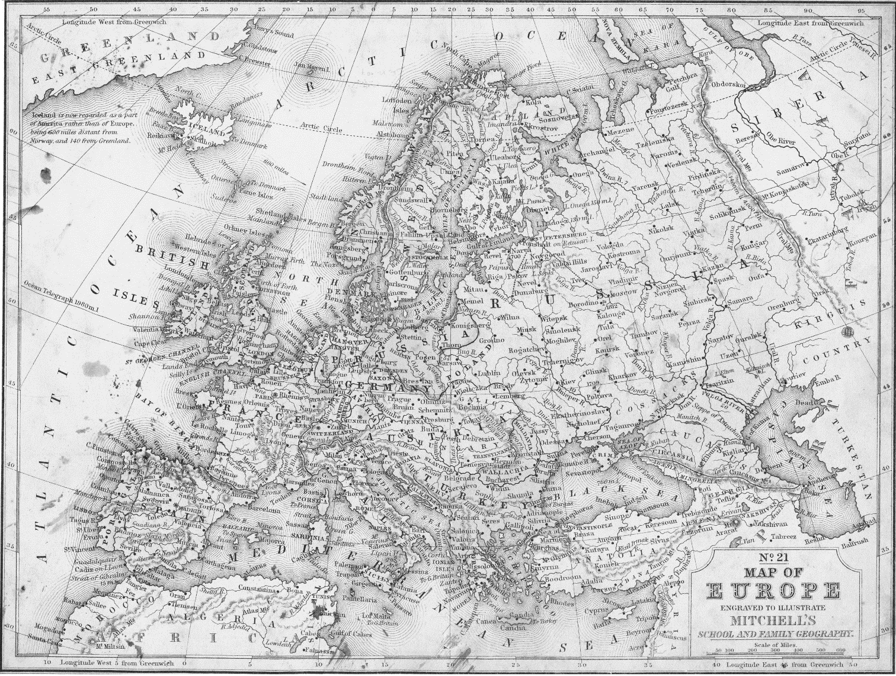

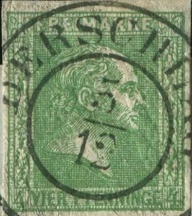

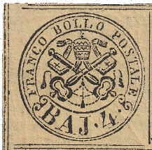

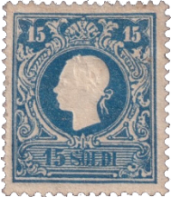

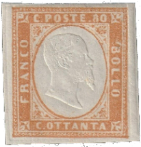

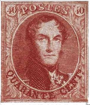

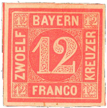

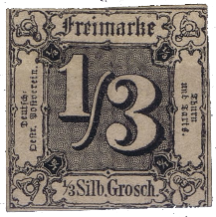

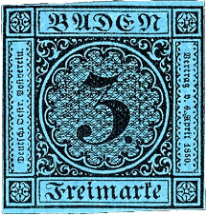

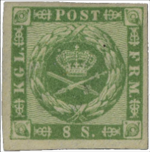

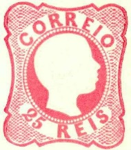

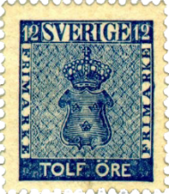

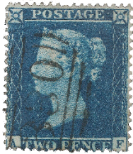

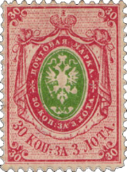

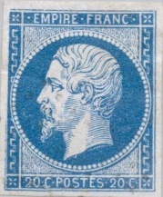

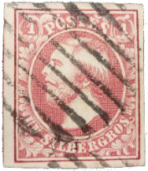

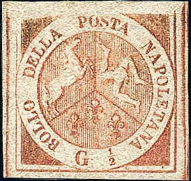

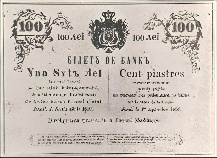

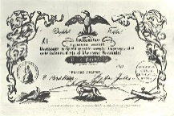

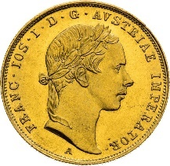

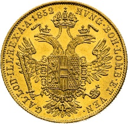

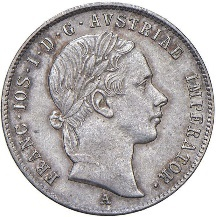

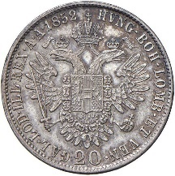

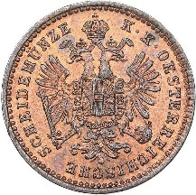

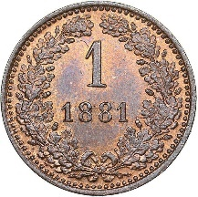

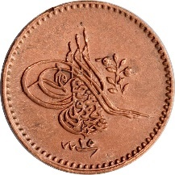

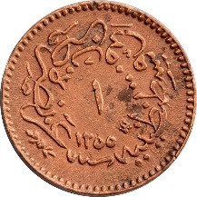

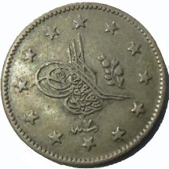

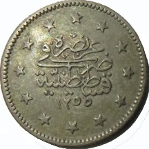

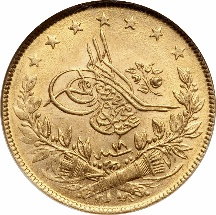

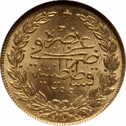

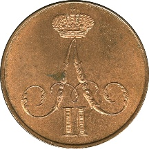

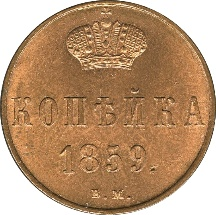

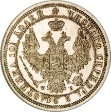

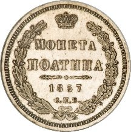

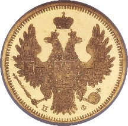

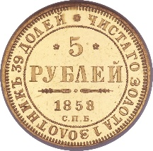

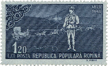

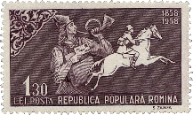

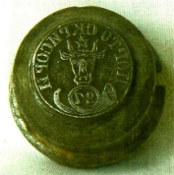

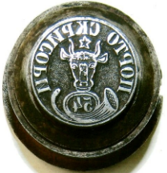

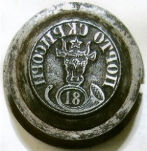

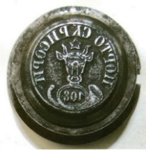

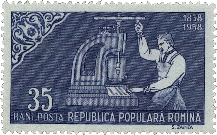

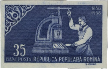

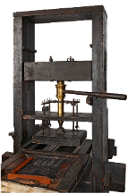

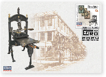

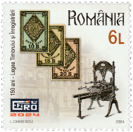

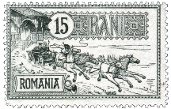

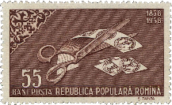

| Table 23: Figures ⏭ 1858 📅 (§4) |  |  |  |
|---|---|---|---|
| Figure 117, p.151 | 🧭 1858 📅 Europe 🌍   Samuel Augustus Mitchell | ⏭ 2024-09-17: https://etc.usf.edu/maps/pages/000/25/25b.pdf |  |
| Figure 118, p.152 | 📖 MI DE-PR 9b | ⏭ 2024-09-18: https://colnect.com/en/stamps/stamp/1021432-King_Friederich_Wilhelm_IV-Friedrich_Wilhelm_IV-Prussia |  |
| Figure 119, p.152 | 📖 MI IT-RS 5c | ⏭ 2024-09-18: https://colnect.com/en/stamps/stamp/444912-Papal_Arms-Papal_Arms_-_Baj-Roman_States |  |
| Figure 120, p.152 | 📖 MI AT-LV 11I | ⏭ 2024-09-18: https://colnect.com/en/stamps/stamp/439117-Emperor_Franz_Joseph-Second_issue-Lombardy-Venetia |  |
| Figure 121, p.152 | 📖 MI IT-SA 14b | ⏭ 2024-09-18: https://colnect.com/en/stamps/stamp/1207837-Vittorio_Emanuele_II-Vittorio_Emanuele_II_reverse_type_words-Sardinia-Piedmont |  |
| Figure 122, p.152 | 📖 MI BE 9I | ⏭ 2024-09-18: https://colnect.com/en/stamps/stamp/190444-King_Leopold_I_-_Round_medallion-King_Leopold_I_Medaillons-Belgium |  |
| Figure 123, p.152 | 📖 MI DE-BY 6 | ⏭ 2024-09-18: https://colnect.com/en/stamps/stamp/327820-Value_in_circle-Kreuzer_square_issue-Bavaria |  |
| Figure 124, p.152 | 📖 MI DE-TT 2 | ⏭ 2024-09-18: https://colnect.com/en/stamps/stamp/326370-Numeral_in_square-Value_on_colored_paper_Groschen-Thurn_and_Taxis |  |
| Figure 125, p.152 | 📖 MI DE-BAD 8 | ⏭ 2024-09-18: https://colnect.com/en/stamps/stamp/326579-Value_in_circle-Value_in_circle-Baden |  |
| Figure 126, p.152 | 📖 MI DK 8 | ⏭ 2024-09-18: https://colnect.com/en/stamps/stamp/41361-Royal_insignia-FIRE_RBS-Denmark |  |
| Figure 127, p.152 | 📖 MI PT 11 | ⏭ 2024-09-18: https://colnect.com/en/stamps/stamp/55614-King_Pedro_V-King_Pedro_V_ringed_hair-Portugal |  |
| Figure 128, p.152 | 📖 MI SE 9a | ⏭ 2024-09-18: https://colnect.com/en/stamps/stamp/50563-Coat-of-Arms_%C3%96re-Coat-of-Arms_%C3%96re-Sweden |  |
| Figure 129, p.152 | 📖 MI GB 11IIA | ⏭ 2024-09-18: https://colnect.com/en/stamps/stamp/1064255-Two_Penny_Blue_Queen_Victoria-Queen_Victoria_-_Line_Engraved-United_Kingdom_of_Great_Britain_Northern_Ireland |  |
| Figure 130, p.152 | 📖 MI RU 4x | ⏭ 2024-09-18: https://colnect.com/en/stamps/stamp/198079-Coat_of_Arms_of_Russian_Empire_Postal_Dep_with_Mantle-1st_Definitive_Issue_of_Russian_Empire-Russia |  |
| Figure 131, p.152 | 📖 MI FR 13Ie | ⏭ 2024-09-18: https://colnect.com/en/stamps/stamp/25438-Emperor_Napoleon_III-Emperor_Napoleon_III-France |  |
| Figure 132, p.152 | 📖 MI LU 2f | ⏭ 2024-09-18: https://colnect.com/en/stamps/stamp/1261183-King_William_III-King_William_III-Luxembourg |  |
| Figure 133, p.152 | 📖 MI IT-NA 1 | ⏭ 2024-09-18: https://colnect.com/en/stamps/stamp/444899-Two_Sicilies_Coat_of_Arms_1st_Plate-Naples |  |
| Figure 134, p.153 | 100 Lei (Not Circulated) 💰 Bank of Moldova 📅 1856 | ⏭ 2025-01-07: https://bancnote.net/BileteMoldova |  |
| Figure 135, p.154 | 10 Ducati (Not Circulated) 💰 Romanian Revolutionary Comittee 🌍 Wallachia 📅 1853 | ⏭ 2025-01-07: https://bancnote.net/TaraRomaneasca |  |
| Figure 136, p.155 | 1 Ducat 💰 Francis Joseph I 📅 1852 – 1859   Obverse | ⏭ 2024-09-20: https://en.numista.com/catalogue/pieces33653.html |  |
| Figure 136, p.155 | Reverse  Composition: Gold (.986) Weight: 3.4909 g ∅: 19.8 mm | ⏭ 📖 KM 2263 |  |
| Figure 137, p.156 | 20 Kreuzers 💰 Francis Joseph I 📅 1852 – 1856  Obverse | ⏭ 2024-09-20: https://en.numista.com/catalogue/pieces7094.html |  |
| Figure 137, p.156 | Reverse  Composition: Silver (.900) Weight: 4.32 g ∅: 22 mm | ⏭ 📖 KM 2211 |  |
| Figure 138, p.157 | 1 Kreuzer 💰 Francis Joseph I 📅 1858 – 1881   Obverse | ⏭ 2024-09-20: https://en.numista.com/catalogue/pieces2360.html |  |
| Figure 138, p.157 | Reverse  Composition: Copper Weight: 3.15 g ∅: 19.25 mm | ⏭ 📖 KM 2186 |  |
| Figure 139, p.159 | 1 Para 💰 Abdülmecid I 📅 1846 – 1859   Obverse | ⏭ 2024-09-20: https://en.numista.com/catalogue/pieces12780.html |  |
| Figure 139, p.159 | Reverse  Composition: Copper Weight: 0.8 g ∅: 13.5 mm | ⏭ 📖 KM 665 |  |
| Figure 140, p. 160 | 1 Kuruş / Piastre 💰 Abdülmecid I 📅 1844 – 1861  Obverse | ⏭ 2024-09-20: https://en.numista.com/catalogue/pieces26557.html |  |
| Figure 140, p. 160 | Reverse  Composition: Silver (.830) Weight: 1.2027 g ∅: 14.5 mm | ⏭ 📖 KM 671 |  |
| Figure 141, p.161 | 100 Kurush 💰 Abdülmecid I 📅 1843 – 1861   Obverse | ⏭ 2024-09-20: https://en.numista.com/catalogue/pieces59645.html |  |
| Figure 141, p.161 | Reverse  Composition: Gold (.917) Weight: 7.216 g ∅: 22 mm | ⏭ 📖 KM 679 |  |
| Figure 142, p.163 | 1 Kopeck 💰 Alexander II 📅 1855 – 1860  Obverse | ⏭ 2025-09-16: https://en.numista.com/catalogue/pieces95158.html |  |
| Figure 142, p.163 | Reverse  Composition: Copper Weight: 5.12 g ∅: 23 mm |  |  |
| Figure 143, p.164 | 1 Poltina 💰 Nikolai I / Aleksander II 📅 1832 – 1858  Obverse | ⏭ 2025-09-16: https://en.numista.com/catalogue/pieces26890.html |  |
| Figure 143, p.164 | Reverse  Composition: Silver (.868) Weight: 10.37 g ∅: 28.5 mm |  |  |
| Figure 144, p.165 | 5 Roubles 💰 Alexander II 📅 1855 – 1858  Obverse | ⏭ 2025-09-16: https://en.numista.com/catalogue/pieces26863.html |  |
| Figure 144, p.165 | Reverse  Composition: Gold (.917) Weight: 6.54 g ∅: 22.6 mm |  |  |
| Figure 145, p.166 | 📖 MI RO 1752A | ⏭ 2024-09-20: https://colnect.com/en/stamps/stamp/212790-Stage-coachman_in_front_of_mail_coach-100_Years_of_Romanian_Stamps-Romania |  |
| Figure 146, p.166 | 📖 MI RO 1753A | ⏭ 2024-09-20: https://colnect.com/en/stamps/stamp/212791-Postman_Blowing_Post_Horn_and_Post_Rider-100_Years_of_Romanian_Stamps-Romania |  |
| Figure 147, p.170 | 27 Parale: Metal die | ⏭ 2024-05-02: https://www.europeana.eu/it/item/2048047/Athena_Plus_ProvidedCHO_Institutul_Na_ional_al_Patrimoniului_B5E80EE0C6624CFCBD7E55B128D39014 |  |
| Figure 148, p.170 | 54 Parale: Metal die | ⏭ 2024-05-06: https://www.europeana.eu/it/item/2048047/Athena_Plus_ProvidedCHO_Institutul_Na_ional_al_Patrimoniului_1F1E016EB0114419AD205604D857A748 |  |
| Figure 149, p.170 | 81 Parale: Metal die | ⏭ 2024-05-06: https://www.europeana.eu/it/item/2048047/Athena_Plus_ProvidedCHO_Institutul_Na_ional_al_Patrimoniului_AA87F4F438EC42549498B7B88AAD9B00 |  |
| Figure 150, p.170 | 108 Parale: Metal die | ⏭ 2024-05-06: https://www.europeana.eu/it/item/2048047/Athena_Plus_ProvidedCHO_Institutul_Na_ional_al_Patrimoniului_A3D32AFFEDCF42E185501E768B87A99F |  |
| Figure 151, p.173 | 📖 MI RO 1750A | ⏭ 2024-05-10: https://colnect.com/en/stamps/stamp/212788-Printer_at_a_manual_stamp_printing_press-100_Years_of_Romanian_Stamps-Romania |  |
| Figure 152, p.174 | 📖 MI RO 1750B | ⏭ 2024-05-10: https://colnect.com/en/stamps/stamp/685904-Printer_at_a_manual_stamp_printing_press-100_Years_of_Romanian_Stamps-Romania |  |
| Figure 153, p.175 | Wooden printing press 📅 First half of the 18th century | ⏭ 2024-09-07: https://mediengeschichte.dnb.de/DBSMZBN/Content/EN/Printing/04-europaeischer-typendruck-en.html |  |
| Figure 154, p.176 | EFIRO 2024  FDC ✉ | ⏭ 2024-09-15: https://www.efiro.ro/content/medals-and-prizes |  |
| Figure 154, p.176 | EFIRO 2024 | ⏭ 2024-09-15: https://colnect.com/en/stamps/stamp/1481115-Fiscal_Stamps_of_1874_and_Printing_Press-EFIRO_2024_Philatelic_Exhibition_Bucharest-Romania |  |
| Figure 155, p.183 | 📖 MI RO 150 | ⏭ 2024-09-26: https://colnect.com/en/stamps/stamp/526279-2nd_Anniv_of_Bucuresti_new_post_office-Bucuresti_Post_hotel-Romania |  |
| Figure 156, p.187 | 📖 MI RO 1751A | ⏭ 2024-09-18: https://colnect.com/en/stamps/stamp/212789-Stamp_strip_Oxhead_and_scissors_cutting-100_Years_of_Romanian_Stamps-Romania |  |
| Figure 157, p.188 | The Paris Convention | ⏭ 2024-09-28: https://ro.wikipedia.org/wiki/Conven%C8%9Bia_de_la_Paris |  |
| Figure 158, p.191 | 10 Parale 📰 Newspaper stamp | ⏭ 📖 Kiriac 1974, Fig 39, p.32 |  |
| Figure 159, p.191 | 10 Parale 📰 Metal Die | ⏭ 2024-05-07: https://www.europeana.eu/it/item/2048047/Athena_Plus_ProvidedCHO_Institutul_Na_ional_al_Patrimoniului_6756841B976146C58C80B43348A0E633 |  |
| Figure 160, p.194 | 1858 📅 🐃 1 & 2: Metal dies | ⏭ 2024-05-04: https://www.lumea-tiparului.ro/Istoria_timbrului_romanesc-o_adevarata_istorie_a_Romaniei.html |  |
