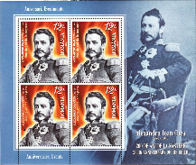
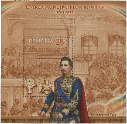
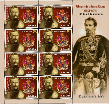
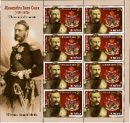

## Figures ⏭ 1859 📅 (§5)

<!-- u:u02027 kind:table -->

| Table 24: Figures ⏭ 1859 📅 (§5) |  |  |  |
|---|---|---|---|
| Figure 161, p.200 | 📖 MI RO 7688AKB | ⏭ 2024-12-11: https://colnect.com/en/stamps/stamp/980239-Alexandru_Ioan_Cuza_1820-1873-200th_Birth_Anniversary_of_Alexandru_Ioan_Cuza-Romania |  |
| Figure 162, p.200 | 📖 MI RO Block 777 | ⏭ 2024-12-11: https://www.ebay.com/itm/192831870554 |  |
| Figure 163, p.202 | 📖 MI RO 8187KBII | ⏭ 2024-12-11: https://colnect.com/en/stamps/stamp/1369229-Alexandru_Ioan_Cuza_First_Prince_of_Romania_II-150th_Death_Anniversary_of_Alexandru_Ioan_Cuza-Romania |  |
| Figure 164, p.202 | 📖 MI RO 8187KBI | ⏭ 2024-12-11: https://colnect.com/en/stamps/stamp/1369228-Alexandru_Ioan_Cuza_First_Prince_of_Romania_I-150th_Death_Anniversary_of_Alexandru_Ioan_Cuza-Romania |  |
| Figure 165, p.205 | 🧭 Europe 🌍 Events before the union 📅 1857 – 1859 | ⏭ 2024-12-31: https://omniatlas.com/maps/europe/18590205/ |  |
| Figure 166, p.205 | 🧭 Europe 🌍 Events shortly after the union 📅 1859 | ⏭ 2024-12-31: https://omniatlas.com/maps/europe/18590604/ |  |
