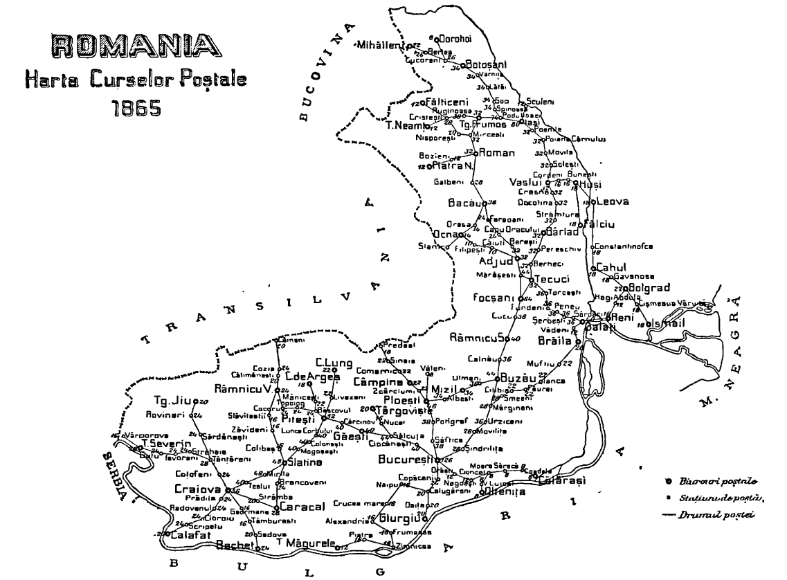

## Figures ⏭ 1865 📅 🧭 Postal Routes 🌍 Romania (§6)

<!-- u:u02029 kind:table -->

| Table 25: Figures ⏭ 1859 📅 (§5) |  |  |  |
|---|---|---|---|
| Figure 167, p.210 | 1865 📅 🧭 Postal Routes 🌍 Romania | ⏭ 📖 Constantin Minescu, p.146 |  |
