## Figures ⏭ 🐃 1 (§10)

<!-- u:u02037 kind:table -->
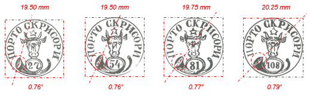

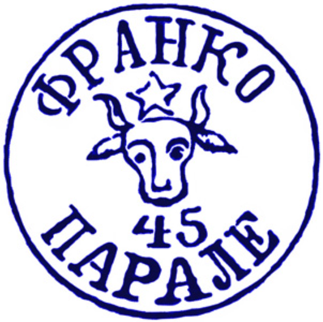

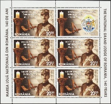

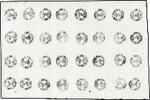

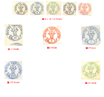

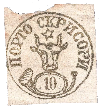

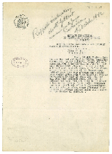

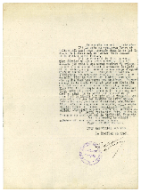

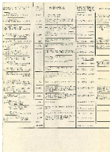

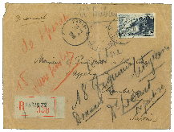

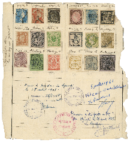

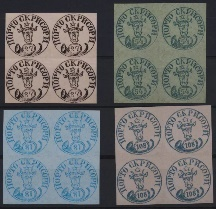

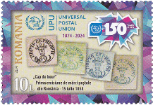

| Table 27: Figures ⏭ 🐃 1 (§10) |  |  |  |
|---|---|---|---|
| Figure 176, p.229 | 🐃 1: ∅ & 📯 | ⏭ 📖 Kiriac 1974, p.44 |  |
| Figure 177, p. 232 | Moroiu 🆁 45 Parale | ⏭ 2024-10-05: https://www.romanianstamps.ro/f0018_falsurile_cap_de_moroiu.php |  |
| Figure 178, p.232 | 📖 MI RO 7690KB | ⏭ 2024-10-05: https://colnect.com/en/stamps/stamp/980241-Grand_Master_Constantin_Moroiu-140th_Anniversary_of_Grand_National_Lodge_of_Romania-Romania |  |
| Figure 179, p.234 | 🐃 1 🆁 Replica ⏭ Gorjan | ⏭ 2024-08-29: https://razboifilatelic.blogspot.com/2008/11/ |  |
| Figure 180, p.235 | 🐃 1 🆁 Replica ⏭ François Fournier | ⏭ 2024-10-05: http://catalogue.klaseboer.com/vol2/html/ruman.htm |  |
| Figure 181, p.235 | 🐃 1 🆁 Replica ⏭ Adolf | ⏭ 2024-10-05: https://www.romaniastamps.com/forg/forgeframe.htm |  |
| Figure 181, p.235 | 🐃 1 🆁 Replica ⏭ Adolf | ⏭ 2024-10-05: https://www.ebay.com/itm/226376960271 |  |
| Figure 182, p.236 | Jean de Sperati | ⏭ 2024-10-11: https://heinrich-koehler.de/en/1-jean-de-sperati-%E2%80%93-caught-his-own-trap |  |
| Figure 182, p.236 | Jean de Sperati | ⏭ 2024-10-11: https://heinrich-koehler.de/en/4-jean-de-speratis-fall |  |
| Figure 183, p.237 | Jean de Sperati | ⏭ Figure 182 |  |
| Figure 183, p.237 | Jean de Sperati | ⏭ Figure 182 |  |
| Figure 184, p.238 | Report 📅 1942-10-15 | ⏭ 2024-10-05: https://www.davidfeldman.com/de/dfsa-auktionen/2022-december/art-of-sperati-collection-dec22/50000/large-lots-and-collections-the-famous-document-whi/ |  |
| Figure 184, p.238 | Report 📅 1942-10-15 | ⏭ Figure 184 |  |
| Figure 185, p.239 | Report 📅 1942-10-15 | ⏭ Figure 184 |  |
| Figure 186, p.239 | ✉ Sperati 📅 1942 | ⏭ Figure 184 |  |
| Figure 187, p.240 | ✉ Sperati 🆁 Replica  € 11`000 📅 2022-12-07 | ⏭ Figure 184 |  |
| Figure 188, p.241 | 🐃 1 🆁 Replica ⏭ Werner | ⏭ 2024-10-13: https://www.ebay.com/itm/167015706189 |  |
| Figure 189, p.242 | 📖 LP 2489 | ⏭ 2025-10-16: https://filatelia.ro/timbre-romania-2024/uniunea-postala-universala-150-de-ani-2024-lp-2489.html |  |
